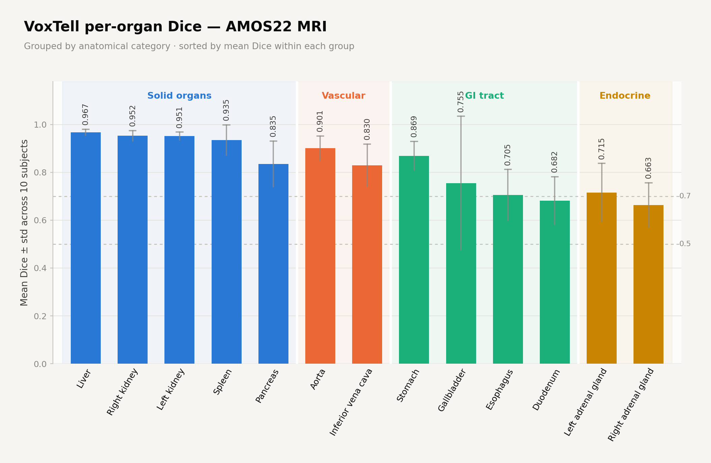
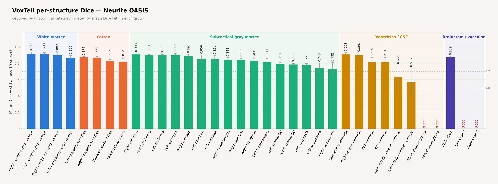

# VoxTell Results — AMOS22 MRI and Neurite OASIS

All numbers below are computed directly from `predictions_voxtell_amos22_mri.csv`
(130 rows: 10 subjects × 13 organs) and `predictions_voxtell_neurite_oasis.csv`
(350 rows: 10 subjects × 35 brain structures) — the raw per-(subject, organ)
prediction logs from the VoxTell Kaggle runs (`voxtell-amos-kaggle.ipynb`,
`voxtell-oasis-kaggle.ipynb`). Dice is the standard volumetric Dice
coefficient between VoxTell's predicted 3D mask and the ground-truth mask,
computed once per (subject, organ) case.

## 1. Overall summary

| Metric | AMOS22 MRI | Neurite OASIS |
|---|---:|---:|
| Subjects | 10 | 10 |
| Organs / structures | 13 | 35 |
| Total (subject, organ) cases | 130 | 350 |
| **Mean Dice** | **0.8277** | **0.7388** |
| Median Dice | 0.8726 | 0.8482 |
| Std. dev. Dice | 0.1489 | 0.2795 |
| Min / Max Dice | 0.0000 / 0.9813 | 0.0000 / 0.9415 |
| Cases with Dice > 0 | 129 / 130 (99.2%) | 310 / 350 (88.6%) |
| Cases with Dice ≥ 0.5 | 126 / 130 (96.9%) | 305 / 350 (87.1%) |
| Cases with Dice ≥ 0.7 | 105 / 130 (80.8%) | 294 / 350 (84.0%) |
| Mean predicted voxels / case | 90,649 | 48,996 |
| Mean inference time / organ | 3.11 s | 0.51 s |
| Total inference time (10 subjects) | 404.0 s (~6.7 min) | 179.6 s (~3.0 min) |

For reference, this is a large improvement over Text3DSAM on the same
AMOS22 MRI sample (mean Dice 0.1025 — see `TEXT3DSAM_RESULTS_ANALYSIS.md`),
and VoxTell is the only one of the three models evaluated so far that
produces non-trivial (non-zero) Dice on Neurite OASIS at all.

## 2. Per-organ Dice — AMOS22 MRI (13 organs, n=10 subjects each)

| Organ | Mean Dice | Std | Min | Max | Nonzero cases |
|---|---:|---:|---:|---:|---:|
| Liver | 0.9672 | 0.0128 | 0.9475 | 0.9806 | 10/10 |
| Right kidney | 0.9523 | 0.0216 | 0.8999 | 0.9705 | 10/10 |
| Left kidney | 0.9511 | 0.0170 | 0.9162 | 0.9687 | 10/10 |
| Spleen | 0.9352 | 0.0632 | 0.7661 | 0.9813 | 10/10 |
| Aorta | 0.9006 | 0.0513 | 0.8244 | 0.9762 | 10/10 |
| Stomach | 0.8686 | 0.0603 | 0.7474 | 0.9430 | 10/10 |
| Pancreas | 0.8353 | 0.0958 | 0.6213 | 0.9448 | 10/10 |
| Inferior vena cava | 0.8297 | 0.0887 | 0.6463 | 0.9159 | 10/10 |
| Gallbladder | 0.7552 | 0.2791 | 0.0000 | 0.9402 | 9/10 |
| Left adrenal gland | 0.7153 | 0.1219 | 0.4483 | 0.8796 | 10/10 |
| Esophagus | 0.7052 | 0.1065 | 0.5628 | 0.8580 | 10/10 |
| Duodenum | 0.6816 | 0.1003 | 0.4845 | 0.8453 | 10/10 |
| Right adrenal gland | 0.6632 | 0.0932 | 0.4682 | 0.7797 | 10/10 |

**Pattern:** large, high-contrast organs (liver, kidneys, spleen, aorta)
cluster at 0.90–0.97 mean Dice; small/thin/variable-shape structures
(adrenal glands, duodenum, esophagus) sit lower at 0.66–0.72. Gallbladder
has the single dataset outlier (one subject at Dice 0.0000, driving its
std to 0.28) — everything else is a smooth, organ-size-correlated gradient
rather than a cliff.

## 3. Per-organ Dice — Neurite OASIS (35 structures, n=10 subjects each)

| Structure | Mean Dice | Std | Min | Max | Nonzero cases |
|---|---:|---:|---:|---:|---:|
| Right cerebral white matter | 0.9188 | 0.0170 | 0.8886 | 0.9398 | 10/10 |
| Left cerebral white matter | 0.9109 | 0.0217 | 0.8637 | 0.9366 | 10/10 |
| Left lateral ventricle | 0.9082 | 0.0250 | 0.8711 | 0.9415 | 10/10 |
| Right putamen | 0.9080 | 0.0180 | 0.8748 | 0.9306 | 10/10 |
| Right thalamus | 0.9005 | 0.0079 | 0.8917 | 0.9155 | 10/10 |
| Left thalamus | 0.8998 | 0.0108 | 0.8773 | 0.9172 | 10/10 |
| Right lateral ventricle | 0.8976 | 0.0291 | 0.8462 | 0.9302 | 10/10 |
| Left putamen | 0.8972 | 0.0215 | 0.8544 | 0.9147 | 10/10 |
| Right cerebellum white matter | 0.8966 | 0.0188 | 0.8559 | 0.9140 | 10/10 |
| Right caudate | 0.8909 | 0.0212 | 0.8438 | 0.9130 | 10/10 |
| Brain stem | 0.8786 | 0.0088 | 0.8608 | 0.8874 | 10/10 |
| Left cerebellum cortex | 0.8739 | 0.0100 | 0.8517 | 0.8874 | 10/10 |
| Right cerebellum cortex | 0.8703 | 0.0136 | 0.8455 | 0.8899 | 10/10 |
| Left cerebellum white matter | 0.8647 | 0.0309 | 0.7896 | 0.8989 | 10/10 |
| Left pallidum | 0.8560 | 0.0477 | 0.7285 | 0.8911 | 10/10 |
| Left caudate | 0.8507 | 0.0441 | 0.7397 | 0.8817 | 10/10 |
| Right hippocampus | 0.8437 | 0.0264 | 0.7896 | 0.8747 | 10/10 |
| Right pallidum | 0.8433 | 0.0173 | 0.8102 | 0.8611 | 10/10 |
| Right amygdala | 0.8306 | 0.0246 | 0.7901 | 0.8757 | 10/10 |
| Right cerebral cortex | 0.8255 | 0.0220 | 0.7778 | 0.8457 | 10/10 |
| 3rd ventricle | 0.8201 | 0.0500 | 0.7164 | 0.8799 | 10/10 |
| 4th ventricle | 0.8127 | 0.0599 | 0.7121 | 0.8856 | 10/10 |
| Left cerebral cortex | 0.8116 | 0.0303 | 0.7551 | 0.8393 | 10/10 |
| Left hippocampus | 0.8110 | 0.0482 | 0.7198 | 0.8659 | 10/10 |
| Left ventral DC | 0.7905 | 0.0183 | 0.7659 | 0.8200 | 10/10 |
| Right ventral DC | 0.7860 | 0.0145 | 0.7628 | 0.8093 | 10/10 |
| Left amygdala | 0.7748 | 0.0237 | 0.7225 | 0.8158 | 10/10 |
| Left accumbens | 0.7430 | 0.0622 | 0.6367 | 0.8428 | 10/10 |
| Right accumbens | 0.7316 | 0.0761 | 0.5370 | 0.8221 | 10/10 |
| Right inferior lateral ventricle | 0.6355 | 0.1427 | 0.3818 | 0.7887 | 10/10 |
| Left inferior lateral ventricle | 0.5758 | 0.1669 | 0.2242 | 0.7763 | 10/10 |
| Right choroid plexus | 0.0000 | 0.0000 | 0.0000 | 0.0000 | 0/10 |
| Left vessel | 0.0000 | 0.0000 | 0.0000 | 0.0000 | 0/10 |
| Left choroid plexus | 0.0000 | 0.0000 | 0.0000 | 0.0000 | 0/10 |
| Right vessel | 0.0000 | 0.0000 | 0.0000 | 0.0000 | 0/10 |

**Pattern:** 31 of 35 structures score in the 0.58–0.92 range — VoxTell
clearly generalizes to detailed neuroanatomy despite AMOS/abdominal-style
training data being the more typical target for these free-text 3D
segmentation models. The **4 structures with Dice = 0.0000 across all 10
subjects** are `choroid plexus` (L/R) and `vessel` (L/R) — small,
low-contrast, and easily confused with surrounding CSF/blood-pool tissue;
this is a total, consistent miss rather than noisy near-zero performance,
suggesting VoxTell essentially never localizes these two structure types
for this dataset regardless of subject.

## 4. Per-subject Dice

| AMOS22 MRI subject | Mean Dice | Std | Neurite OASIS subject | Mean Dice | Std |
|---|---:|---:|---|---:|---:|
| amos_0575 | 0.8990 | 0.0782 | OASIS_OAS1_0135_MR1 | 0.7535 | 0.2813 |
| amos_0555 | 0.8901 | 0.1021 | OASIS_OAS1_0062_MR1 | 0.7477 | 0.2797 |
| amos_0558 | 0.8515 | 0.1052 | OASIS_OAS1_0014_MR1 | 0.7438 | 0.2854 |
| amos_0532 | 0.8479 | 0.1147 | OASIS_OAS1_0421_MR1 | 0.7426 | 0.2877 |
| amos_0554 | 0.8451 | 0.1313 | OASIS_OAS1_0151_MR1 | 0.7416 | 0.2796 |
| amos_0508 | 0.8103 | 0.1383 | OASIS_OAS1_0057_MR1 | 0.7401 | 0.2851 |
| amos_0544 | 0.7991 | 0.1403 | OASIS_OAS1_0419_MR1 | 0.7393 | 0.2819 |
| amos_0553 | 0.7987 | 0.1616 | OASIS_OAS1_0076_MR1 | 0.7305 | 0.3005 |
| amos_0530 | 0.7980 | 0.1558 | OASIS_OAS1_0363_MR1 | 0.7280 | 0.2765 |
| amos_0522 | 0.7374 | 0.2612 | OASIS_OAS1_0123_MR1 | 0.7210 | 0.2713 |

OASIS per-subject means are far tighter together (0.721–0.754, a 0.033
spread) than AMOS's (0.737–0.899, a 0.162 spread) — mainly because OASIS's
four always-zero structures (choroid plexus × 2, vessel × 2) drag every
subject down by roughly the same fixed amount, while AMOS's variation is
driven by a couple of subject-specific harder cases (e.g. amos_0522's low
0.7374 mean, standard deviation 0.26 — likely one or two organs with a
poor prediction for that subject specifically).

## 5. Left/right laterality Dice gap

For organs/structures with an explicit left and right instance, comparing
their mean Dice directly (no axis-label bookkeeping needed — this is a
plain overlap-quality comparison) gives a simple, robust view of whether
VoxTell segments one side systematically better than the other:

**AMOS22 MRI**

| Organ | Left Dice | Right Dice | \|L − R\| gap |
|---|---:|---:|---:|
| Adrenal gland | 0.7153 | 0.6632 | 0.0522 |
| Kidney | 0.9511 | 0.9523 | 0.0012 |

Mean \|L−R\| gap: **0.0267**

**Neurite OASIS** (16 paired structures)

| Structure | Left Dice | Right Dice | \|L − R\| gap |
|---|---:|---:|---:|
| Inferior lateral ventricle | 0.5758 | 0.6355 | 0.0597 |
| Amygdala | 0.7748 | 0.8306 | 0.0559 |
| Caudate | 0.8507 | 0.8909 | 0.0402 |
| Hippocampus | 0.8110 | 0.8437 | 0.0327 |
| Cerebellum white matter | 0.8647 | 0.8966 | 0.0319 |
| Cerebral cortex | 0.8116 | 0.8255 | 0.0139 |
| Pallidum | 0.8560 | 0.8433 | 0.0126 |
| Accumbens | 0.7430 | 0.7316 | 0.0114 |
| Putamen | 0.8972 | 0.9080 | 0.0108 |
| Lateral ventricle | 0.9082 | 0.8976 | 0.0106 |
| Cerebral white matter | 0.9109 | 0.9188 | 0.0079 |
| Ventral DC | 0.7905 | 0.7860 | 0.0045 |
| Cerebellum cortex | 0.8739 | 0.8703 | 0.0037 |
| Thalamus | 0.8998 | 0.9005 | 0.0007 |
| Choroid plexus | 0.0000 | 0.0000 | 0.0000 |
| Vessel | 0.0000 | 0.0000 | 0.0000 |

Mean \|L−R\| gap: **0.0185**

Both datasets show small, single-digit-percentage-point left/right gaps on
average, with **right-side structures scoring slightly higher than their
left counterpart in a majority of OASIS pairs** (9 of 14 non-zero pairs
favor right; the exceptions are accumbens, cerebellum cortex, lateral
ventricle, pallidum, and ventral DC). The largest single-structure gaps — inferior lateral
ventricle (0.060) and amygdala (0.056) — are on structures that also have
the lowest overall Dice in their category, consistent with harder/smaller
structures being where any side-dependent effect is most visible, rather
than a uniform bias present everywhere.

## 6. Caveat on the CSV's `pred_side_axis*` / `gt_side_axis*` columns

The prediction CSVs also carry per-axis anatomical side labels
(`pred_side_axis0/1/2`, `gt_side_axis0/1/2`, values like R/L, A/P, S/I) that
look like a ready-made input for a finer-grained "did the predicted mask
land on the correct anatomical side" laterality metric. **We spot-checked
this and found the predicted-side labels are not reliable for that
purpose**: e.g. for AMOS22 MRI, `right kidney` predictions are labeled `L`
on `pred_side_axis0` in 9/10 subjects despite Dice ≈ 0.90–0.97 (i.e. the
mask genuinely, correctly overlaps the true right kidney) — the *label* is
wrong even though the underlying *mask* is right. This traces to the
Kaggle notebook's `pred_side_axis*` computation assuming the VoxTell
predictor's output array is always in plain `("R","A","S")`-per-axis order,
which does not hold for every axis in practice. Category-matched
(letter-set, not axis-index) comparison confirms the pattern: A/P labels
match ground truth ~98–99% of the time, but the L/R- and S/I-category axes
only match ~40–55% of the time — far below what Dice says should be
possible, and the mismatch direction is consistent across subjects (not
random noise), which is the signature of a systematic labeling bug, not a
real model laterality confusion.

**Practical takeaway:** use §5's Dice-based left/right comparison (which
only depends on voxel overlap, not axis labeling) for any laterality claim
in the paper. Don't report a "predicted side matches ground-truth side"
percentage from the raw CSV columns without first fixing the notebook's
`mask_ground_truth_3d()`/`pred_side_axis*` derivation to use each volume's
*actual* reoriented axis codes instead of a hardcoded `("R","A","S")`
assumption.

## 7. Source data

- `predictions_voxtell_amos22_mri.csv` — 130 rows
- `predictions_voxtell_neurite_oasis.csv` — 350 rows
- Per-(subject, organ) overlay panels: `results_voxtell_amos/<subject_id>/<organ>.png`,
  `results_voxtell_oasis/<subject_id>/<organ>.png`
- Generated by `voxtell-amos-kaggle.ipynb` / `voxtell-oasis-kaggle.ipynb` on Kaggle GPU
  (T4/P100), VoxTell v0.1.0 (PyPI), checkpoint `mrokuss/VoxTell` `voxtell_v1.1`, zero-shot
  (no fine-tuning).
- Per-organ Dice bar charts (`voxtell_dice_amos.png`, `voxtell_dice_oasis.png`):
  `scripts/plot_voxtell_dice_charts.py`, rerun any time the CSVs change.
