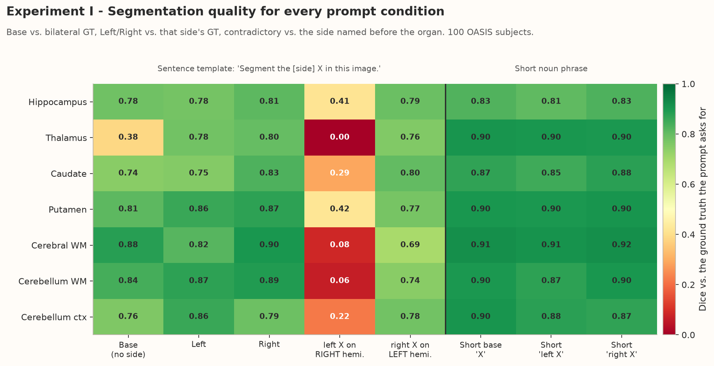
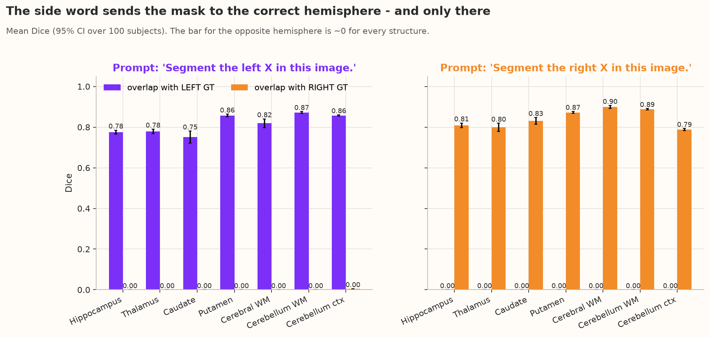
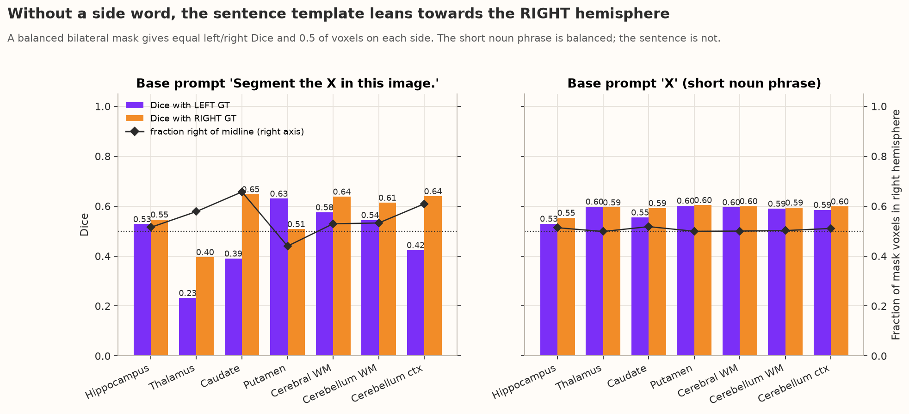
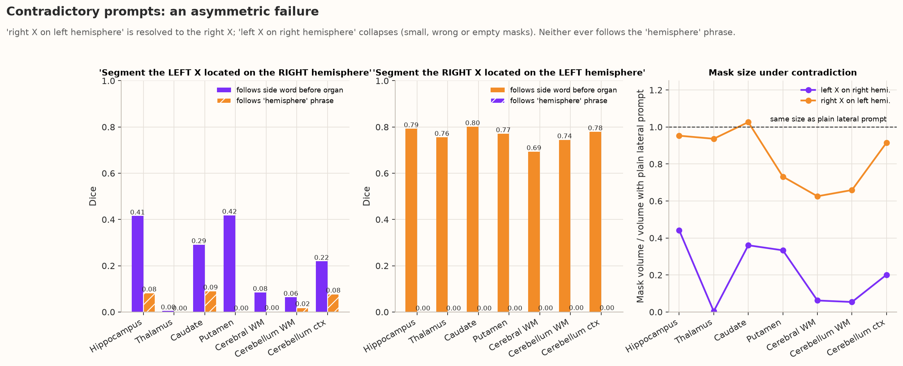
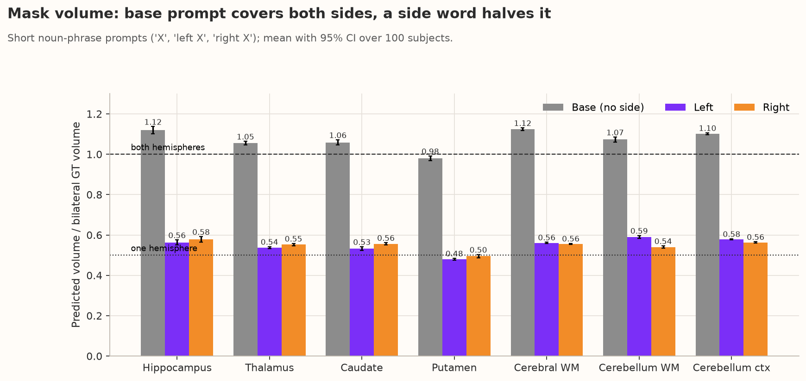
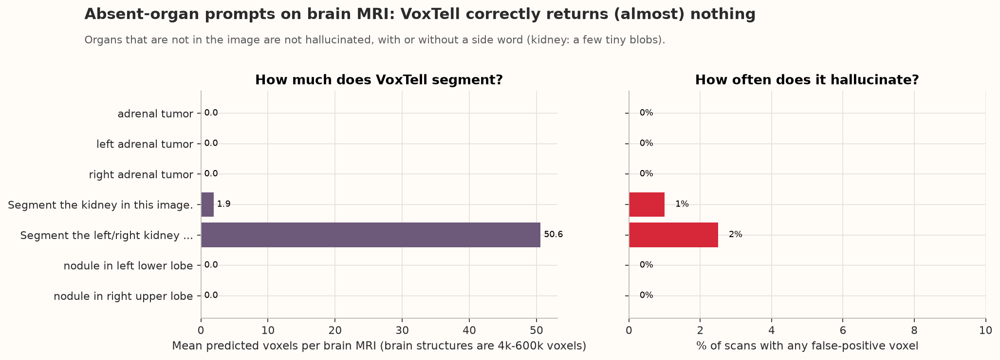
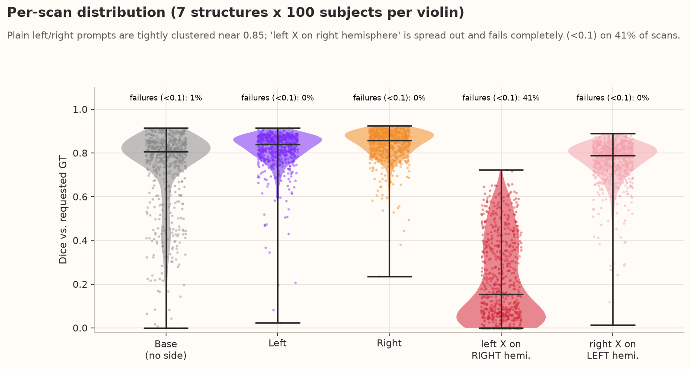
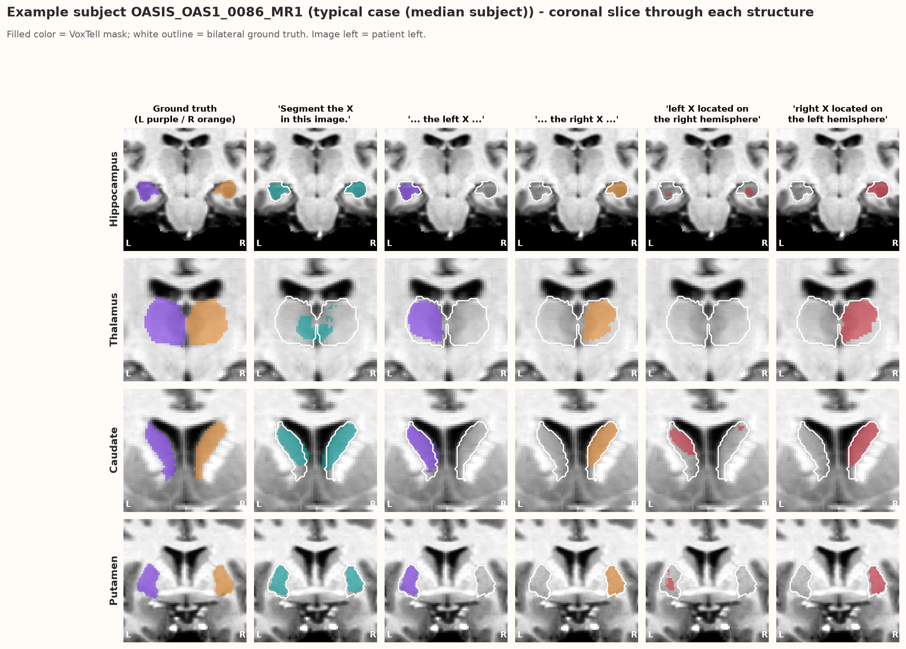
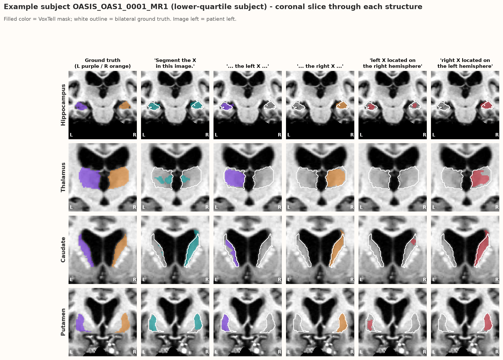
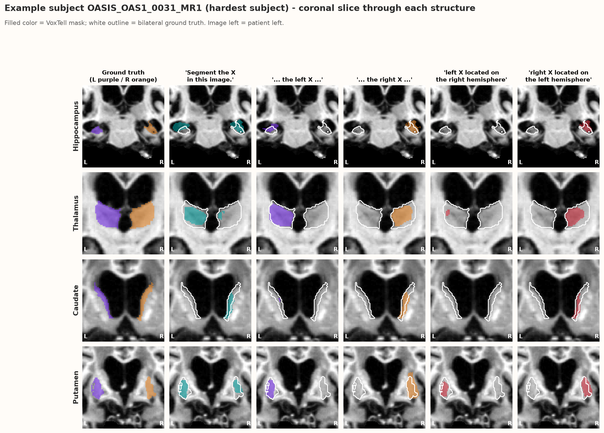

# Experiment I — Does the side word change VoxTell's output?

**Folder:** `results_axis2_exp1/` · **Raw outputs:** `exp1_side_word_comparison/` · **Figures:** [`plots/`](plots/) · **Script:** `analysis/plot_axis2_exp1.py`

---

## 0. Research goal — what we were looking for

The Axis II plan states the goal as: *test whether location words in a text prompt ("left", "right") actually change VoxTell's outputs. If outputs barely change when the words change, the text is not driving laterality.* For Experiment I this was broken down into concrete expectations:

| # | What we expected **if VoxTell truly understands side** | How we measured it |
|---|---|---|
| **G1** | "left" and "right" masks are largely **disjoint**, each on its own hemisphere | Dice between left/right masks, Dice vs. left/right GT, wrong-side rate, centroid shift |
| **G2** | A prompt **without a side** is neutral and covers both hemispheres equally | Dice vs. each side's GT, fraction of mask right of the midline, volume |
| **G3** | A **contradictory** prompt gives an empty or very small mask (the model notices the mismatch) | volume, Dice, % empty masks |
| **G4** | A prompt for an organ that is **not in the image** gives an empty mask (no hallucination) | predicted voxels, % scans with any false positive |
| **F** | **Failure criterion:** if base / left / right outputs are nearly identical, the side word changes nothing | `failure_nearly_identical_rate` |

The answers are collected in **Section 5b** below.

## The whole experiment in one paragraph

We ran VoxTell on 100 brain MRIs from Neurite-OASIS and asked it to segment seven paired brain structures with prompts that differ only in their side information — no side, "left", "right", two self-contradictory sentences — plus prompts for organs that do not exist in a brain scan; in total 6,400 masks were compared with the FreeSurfer ground truth. The side word clearly works: "left" prompts land on the left structure and "right" prompts on the right one (Dice ≈ 0.82–0.89, **zero** wrong-side errors, left and right masks disjoint in 99.4 % of pairs, and base/left/right outputs were never nearly identical), and the mask volume halves when a side is added, which shows VoxTell really segments one structure instead of two. Two weaknesses appear. First, without a side word the full sentence "Segment the X in this image." is **not neutral**: it under-segments the left hemisphere (Dice with the right GT 0.57 vs 0.47 with the left GT; thalamus only 0.38), whereas the bare noun "X" is perfectly balanced. Second, contradictory prompts are handled **asymmetrically**: "right X located on the left hemisphere" is simply read as "right X", while "left X located on the right hemisphere" collapses (mean Dice 0.21, 41 % of scans fail, 14 % of masks empty). Prompts for absent organs return essentially nothing. Overall, VoxTell follows explicit side words reliably but shows a **right-hemisphere preference** whenever laterality is missing or conflicting.

**Main findings:**

- Side words work: 0 % wrong-side errors, left/right masks disjoint in 99.4 % of pairs, Dice 0.82–0.89.
- Adding a side word halves the mask volume — VoxTell segments one structure instead of two.
- The no-side **sentence** leans right (Dice right 0.57 vs left 0.47); the no-side **short noun** is balanced.
- Contradictions are asymmetric: "right X on left hemisphere" → normal right mask; "left X on right hemisphere" → collapse (Dice 0.21, 41 % failures).
- Absent organs are not hallucinated (0 voxels for adrenal/lung; ≤ 2 % tiny kidney false positives).

## 1. The question in plain words

VoxTell is a text-prompted 3D segmentation model: you give it an MRI and a sentence such as *"Segment the left hippocampus in this image."* and it returns a 3D mask.
Many brain structures exist twice (left and right hemisphere). This experiment asks:

1. If we add **"left"** or **"right"** to the prompt, does the mask actually move to that hemisphere?
2. If we give **no side** ("Segment the hippocampus"), do we get both sides, and are they treated equally?
3. If the prompt **contradicts itself** ("the left hippocampus located on the right hemisphere"), what does VoxTell do?
4. If we ask for an organ that is **not in the image** (kidney, adrenal tumour, lung nodule on a brain MRI), does VoxTell invent something?

## 2. What was run

| Item | Value |
|---|---|
| Data | Neurite-OASIS, **100 brain MRIs** (T1, 160×224×192, with left/right FreeSurfer labels) |
| Structures | 7 bilateral structures: hippocampus, thalamus, caudate, putamen, cerebral white matter, cerebellum white matter, cerebellum cortex |
| Prompt conditions | Base (no side), Left, Right — each as a full sentence *and* as a short noun phrase (`"hippocampus"`, `"left hippocampus"`); two contradictory sentences; 7 absent-organ prompts |
| Metric | **Dice** (0 = no overlap, 1 = perfect overlap) against the ground truth (GT) of the requested side; for base prompts against both sides together |
| Extra | mask volume, fraction of voxels right of the midline, overlap between the left-prompt and right-prompt masks |

Rows in `metrics.csv`: 6,400 (100 subjects × 64 prompt evaluations).

## 3. Results, figure by figure

### 3.1 Overview heat-map — [`01_dice_heatmap_by_condition.png`](plots/01_dice_heatmap_by_condition.png)

**In one paragraph:** This heat-map is the whole experiment in one picture. Reading across a row tells you how one structure reacts to the different prompts; reading down a column tells you whether a prompt condition works for all structures. Almost the whole map is green, so VoxTell segments the requested structure well whether it is asked with or without a side word, and with a sentence or a short phrase. The two clear exceptions are the red vertical stripe of "left X on RIGHT hemi.", which fails for every structure, and the single yellow cell for the thalamus with the base sentence. Because the mirror contradiction and the short base prompt are green, the problem is not the structure itself but the specific wording of the prompt.

**Main findings:**

- Plain left/right prompts: green everywhere (0.75–0.92).
- "left X on RIGHT hemi." fails for every structure (0.00–0.42).
- Thalamus with the base sentence is weak (0.38) but fine with the short base prompt (0.90).
- Failures depend on the wording, not on the structure.

**What it shows:** one cell = mean Dice for one structure and one prompt condition.

**What we see:**
- Plain **left/right** prompts work well: mean Dice **0.82 (left)** and **0.84 (right)** for sentences, **0.87 / 0.89** for short phrases.
- The column **"left X on RIGHT hemi."** is red everywhere (mean Dice **0.21**; thalamus 0.00, cerebellum WM 0.06).
- The mirror column **"right X on LEFT hemi."** is green (mean **0.76**).
- The **sentence base prompt** for the thalamus is poor (**0.38**), while the short base prompt `"thalamus"` is excellent (0.90).

### 3.2 Side words send the mask to the right place — [`02_left_right_prompts_hit_correct_side.png`](plots/02_left_right_prompts_hit_correct_side.png)

**In one paragraph:** If VoxTell ignored the side word, the purple and orange bars would be similar in each panel. Instead, in the left panel only the purple bars (overlap with the left GT) are high and in the right panel only the orange bars (right GT) are high — for every structure — while the "wrong" bar is practically zero. The narrow confidence intervals show that this holds for all 100 subjects, not as an average of good and bad cases. This is the main positive result of Experiment I: the words "left" and "right" are understood in the patient's anatomical frame and translated into the correct hemisphere.

**Main findings:**

- Each side prompt overlaps only its own side's GT; the opposite-side bar is ≈ 0.
- Holds for all 7 structures with narrow confidence intervals (all 100 subjects).
- "Left"/"right" are interpreted in the patient's anatomical frame.

For every structure, the "left" prompt overlaps the left GT (Dice 0.75–0.87) and has **~0 overlap with the right GT**, and vice-versa.
Across all 1,400 left/right pairs the two masks were **disjoint in 99.4 %** of cases and the **wrong-side error rate was 0 %**.
→ *VoxTell understands "left" and "right" in the anatomical (patient) sense.*

### 3.3 The no-side sentence leans right — [`03_base_prompt_right_hemisphere_preference.png`](plots/03_base_prompt_right_hemisphere_preference.png)

**In one paragraph:** Here we look only at prompts without a side word. A truly neutral prompt gives two bars of equal height and a black line at 0.5 (half of the mask on each side). The right panel (bare noun, e.g. "caudate") shows exactly that. The left panel (full sentence) does not: for most structures the orange bar is taller and the black line sits above 0.5, meaning more of the mask lies in the right hemisphere — caudate and thalamus most clearly, while putamen is the only structure tilted the other way. Since the brains and the structures are identical in both panels, the imbalance is caused by the sentence wording; it is a **prompt-induced positional bias**, not a property of the anatomy.

**Main findings:**

- Short noun phrase: balanced (≈ 50 % of voxels on each side).
- Full sentence: more mask on the right — caudate 66 %, cerebellum cortex 61 %, thalamus 58 %.
- Putamen is the only structure that tilts left.
- Same images, different wording → the bias is prompt-induced.

A neutral prompt should give equal overlap with the left and the right structure and put ~50 % of its voxels on each side.
- **Short base prompt (`"caudate"`)**: perfectly balanced (Dice ≈ 0.55–0.60 on each side, 50 % right of midline).
- **Sentence base prompt (`"Segment the caudate in this image."`)**: lopsided. Averaged over structures, Dice with the right GT is **0.57** vs **0.47** with the left GT. Caudate puts **66 %** of its mask on the right, cerebellum cortex **61 %**, thalamus **58 %**. Putamen is the one structure that leans left.

→ This is a **positional (laterality) bias**: when the side is unspecified, the sentence template makes VoxTell under-segment the left hemisphere.

### 3.4 Contradictory prompts fail asymmetrically — [`04_contradictory_prompt_asymmetry.png`](plots/04_contradictory_prompt_asymmetry.png)

**In one paragraph:** The two left panels ask which part of a contradictory sentence VoxTell obeys: the side word in front of the organ (solid bars) or the "located on the … hemisphere" phrase (hatched bars). The hatched bars are almost zero everywhere, so the trailing location phrase is essentially ignored. The difference between the two panels is the key finding: when the organ is called "right", VoxTell produces a normal right mask (Dice ≈ 0.7–0.8); when it is called "left" but the sentence also contains "right", the left mask weakens or disappears. The third panel confirms this with volume — "right X on left hemisphere" keeps 60–100 % of the usual mask size, "left X on right hemisphere" keeps only 0–45 %. So the word "right" interferes with a left request, but "left" does not interfere with a right request.

**Main findings:**

- The trailing "located on the … hemisphere" phrase is essentially ignored (hatched bars ≈ 0).
- "right X on left hemisphere": normal right mask (Dice 0.69–0.80, 60–100 % of normal volume).
- "left X on right hemisphere": shrunken or empty mask (0–45 % of normal volume).
- The word "right" disturbs a left request, but not the other way round.

| Prompt | What VoxTell does |
|---|---|
| "Segment the **right** X located on the **left** hemisphere" | Follows the word *right* (the side word attached to the organ). Dice 0.69–0.80, mask almost as large as a normal right prompt. |
| "Segment the **left** X located on the **right** hemisphere" | **Collapses**: masks shrink to 0–45 % of normal size, **14 % of masks are empty**, **41 % of scans fail (Dice < 0.1)**. Only 4 % of cases move to the "hemisphere" side. |

In neither case does VoxTell obey the trailing *"located on the … hemisphere"* phrase. The asymmetry suggests that the token **"right"** carries a stronger pull than **"left"**: when *right* appears anywhere in the sentence, it disrupts a left request, but *left* in the trailing phrase does not disrupt a right request.

### 3.5 Mask volume — [`05_mask_volume_base_vs_side.png`](plots/05_mask_volume_base_vs_side.png)

**In one paragraph:** This figure checks that the side word changes *what* is segmented, not just where a blob is placed. Without a side, the predicted volume is about the volume of both structures together (bars around the dashed 1.0 line, slightly above because VoxTell draws slightly generous boundaries). With "left" or "right" the volume drops to about half (dotted 0.5 line), and the left and right masks are almost the same size. VoxTell therefore segments one complete structure for a lateral prompt and both structures for a neutral prompt — exactly the expected behaviour.

**Main findings:**

- Base prompt ≈ 1.0–1.1× bilateral GT volume (both structures).
- Left / right prompt ≈ 0.5× (one structure); left and right masks are similar in size.
- VoxTell segments a whole structure per side, it does not just shift a blob.

Base prompts produce ~1.0–1.1× the bilateral GT volume (both sides); left/right prompts produce ~0.5× (one side). The model is not just shifting a blob — it truly segments one vs. two structures.

### 3.6 Absent organs — [`06_absent_organ_negative_prompts.png`](plots/06_absent_organ_negative_prompts.png)

**In one paragraph:** These prompts ask for organs that cannot exist in a brain MRI (kidney, adrenal tumour, lung nodule), with and without a side word; the ideal answer is an empty mask. VoxTell returns exactly zero voxels for all adrenal and lung prompts on all 100 scans. For "kidney" it occasionally outputs a few dozen stray voxels on 1–2 % of scans, which is negligible next to real brain structures of thousands of voxels. Adding a side word does not provoke hallucination either. VoxTell is therefore not simply drawing *something* for every prompt — it checks whether the image actually contains the requested anatomy.

**Main findings:**

- Adrenal tumour and lung nodule prompts: 0 voxels on all 100 scans.
- Kidney: a few stray voxels on 1–2 % of scans only.
- Side words do not trigger hallucinations.

Prompts for adrenal tumours or lung nodules returned **exactly zero voxels on all 100 brains**. Kidney prompts produced a handful of tiny false positives (1–2 % of scans, mean 2–51 voxels). → *VoxTell does not hallucinate organs that are not present, with or without a side word.*

### 3.7 Per-scan distribution — [`07_per_scan_dice_distribution.png`](plots/07_per_scan_dice_distribution.png)

**In one paragraph:** Averages can hide failures, so this figure shows every scan (700 points per condition: 7 structures × 100 subjects). Plain left and right prompts form compact clouds around Dice 0.85 with no failed scans — the side word works reliably, not just on average. The base sentence is mostly good but has a long tail of weaker scans (mainly the thalamus). The "left X on right hemisphere" violin is low and wide: depending on the scan, the result ranges from total failure to moderate overlap, so the outcome of this prompt is unpredictable. Its mirror, "right X on left hemisphere", looks almost like a normal right prompt.

**Main findings:**

- Left/right prompts: compact around Dice 0.85, 0 % failures.
- Base sentence: mostly good, with a tail of weak scans (mainly thalamus), 1 % failures.
- "left X on right hemisphere": widely spread, 41 % failures — unpredictable per scan.
- "right X on left hemisphere": behaves like a normal right prompt (0 % failures).

Left/right prompts are tight around Dice ≈ 0.85 with essentially no failures. The base sentence has a long tail (mostly the thalamus). The "left on right" contradiction is spread from 0 to 0.7.

### 3.8 Example masks — [`08_example_masks_side_and_contradictory_0086.png`](plots/08_example_masks_side_and_contradictory_0086.png), [`08_example_masks_side_and_contradictory_0001.png`](plots/08_example_masks_side_and_contradictory_0001.png), [`08_example_masks_side_and_contradictory_0031.png`](plots/08_example_masks_side_and_contradictory_0031.png)

*The three example subjects were picked by their mean Dice on the plain base/left/right sentences in Experiment I: **OAS1_0086** is the median (typical) subject, **OAS1_0001** sits at the lower quartile, and **OAS1_0031** is the hardest of the 100 scans. Together they show what VoxTell does on a normal, a slightly worse and a difficult brain.*

**Subject OAS1_0086 (typical case — median subject)**

**Subject OAS1_0001 (lower-quartile subject)**

**Subject OAS1_0031 (hardest subject of the 100)**

**Simple reading of the example masks (OAS1_0001):** Each row is one structure of the same patient and each column is one prompt; the white outline shows where the real structures are and the coloured area is what VoxTell drew (image left = patient left). With no side word (teal) VoxTell usually colours both structures — but for the caudate most of the colour sits on the right one, and for the thalamus only a few small patches appear, which is the right-leaning / weak base-sentence behaviour seen in the averages. With "left" (purple) only the left outline is filled, and with "right" (orange) only the right outline is filled. With "left X located on the right hemisphere" (5th column) the masks become tiny, partly on the wrong side, or completely empty (thalamus), while "right X located on the left hemisphere" (last column) looks just like a normal right mask. This single patient therefore shows every main finding of the experiment.

**Main findings:**

- **OAS1_0086 (typical):** left and right prompts fill exactly one outline each (Dice 0.79–0.89). The base sentence covers both caudates and putamina well (0.79), but for the thalamus it again draws only small central patches (Dice 0.43). "left X on right hemisphere" gives small blobs (hippocampus 0.16, caudate/putamen 0.36) or nothing (thalamus 0.00), while "right X on left hemisphere" gives normal right masks.
- **OAS1_0001 (lower quartile):** same pattern; the base caudate mask lies 90 % on the right (Dice 0.55), the base thalamus is weak (0.39), and "left caudate/thalamus on the right hemisphere" is empty (Dice 0.00 / 0.01).
- **OAS1_0031 (hardest):** the right-side preference is extreme — the base caudate mask is **100 %** on the right (Dice 0.33), and even the plain "left caudate" prompt **fails** (Dice 0.02) while "right caudate" works (0.55). The base thalamus mask, by contrast, sits mostly on the left (only 10 % right) with Dice 0.38 — on this scan the no-side sentence is unstable rather than simply right-leaning. Contradictory left prompts again collapse (0.00–0.07, putamen 0.60 is the exception).
- **Across all three subjects:** explicit left/right prompts work, the base sentence is the weak point for thalamus and caudate, and "left X on right hemisphere" fails — the population-level findings are visible in individual patients, and get worse (not different) on harder scans.

Subject OAS1_0001, coronal slices. Note the tiny thalamus mask for the base sentence, the clean left/right masks, the near-empty "left X on right hemisphere" masks and the right-sided masks for "right X on left hemisphere".

## 4. Why is this happening? (interpretation)

1. **Side words are learned well.** VoxTell's text encoder (frozen Qwen3) produces different embeddings for "left X" and "right X", and its prompt decoder + image decoder map them onto the correct hemisphere. Most likely the training data contained many lateralised labels (e.g. "left kidney", "right lung"), so this mapping was learned explicitly.
2. **The default without a side word is not symmetric.** In the sentence template, the side-less representation sits closer to the "right" representation *once it is fused with the image* (Experiment III, `exp3_03`: 5 of 7 structures lean right at the first fusion stage, and putamen — the one structure that leans left here — also leans left there). So the decoder partly behaves as if "right" was requested. The short noun phrase does not have this problem — the bias comes from how the full sentence is encoded, not from the anatomy.
3. **Conflicting side words are not resolved by syntax.** VoxTell does not parse "located on the right hemisphere" as a location constraint; it sees two side tokens. Our working hypothesis is that the "right" token exerts the stronger pull (consistent with point 2), so "left … right" produces a confused, shrunken mask, while "right … left" stays right.
4. **Absent organs are rejected** because the image features never match the text query strongly enough to cross the 0.5 probability threshold.

## 5. Limitations

- One dataset (healthy/elderly T1 brains). Results may differ for other modalities or for pathology.
- Only 7 bilateral structures; only one contradictory template per side.
- The thalamus base-sentence failure is specific to that structure + template.
- NIfTI copies exist only for 3 subjects; all 100 subjects are stored as packed masks (`masks/*.npz`).

## 5b. Answers to the research questions

| # | Expected if VoxTell understands side | What we found | Answer |
|---|---|---|---|
| **G1** | Left/right masks disjoint, each on its own side | Wrong-side rate 0 %, masks disjoint in 99.4 % of pairs, opposite-side Dice ≈ 0, centroid shift 24–56 voxels | ✅ **Confirmed** |
| **G2** | Base prompt neutral (both sides equally) | Short noun neutral (≈ 50 % right of midline). Sentence leans right: Dice right 0.57 vs left 0.47; caudate 66 % right; thalamus Dice 0.38 | ⚠️ **Only for short prompts** — the sentence template has a right-hemisphere bias |
| **G3** | Contradictory prompt → empty / small mask | "left X on right hemi.": small or empty (0–45 % volume, 14 % empty, 41 % fail) ✔. "right X on left hemi.": normal right mask, contradiction ignored ✘ | ⚠️ **Half** — VoxTell does not detect the contradiction; it just gets confused when "right" disturbs a left request |
| **G4** | Absent organ → empty mask | 0 voxels for adrenal / lung prompts; kidney ≤ 2 % of scans with a few voxels | ✅ **Confirmed** |
| **F** | Failure criterion: outputs nearly identical | `failure_nearly_identical_rate` = 0 for every structure | ✅ **Not triggered** — the side word does drive the output |

**In one paragraph:** The central question of Axis II — *does the text actually drive laterality?* — is answered **yes** for VoxTell: changing only "left"/"right" moves the mask to the correct hemisphere in every structure and every subject, and absent organs are not hallucinated. However, the expectations about robustness are only partly met. A side-less sentence is not neutral but leans right, and a self-contradictory sentence is not recognised as contradictory: it either silently follows the first side word ("right X …") or breaks down ("left X … right hemisphere"). Both weaknesses point in the same direction — a stronger pull of the right hemisphere / the word "right" — which Experiments III and V then trace to the text–image fusion stages.

**Main findings:**

- Text does drive laterality in VoxTell (G1 ✅, failure criterion not triggered).
- Absent organs are rejected (G4 ✅).
- No-side sentence is not neutral (G2 ⚠️) and contradictions are not detected (G3 ⚠️).
- Both weaknesses point to a stronger pull of the right hemisphere / the word "right".

## 6. Verdict

| Question | Answer |
|---|---|
| Does the side word change the output? | **Yes — strongly and correctly.** 0 % wrong-side errors, left/right masks disjoint in 99 % of cases. |
| Is the no-side prompt neutral? | **No.** The sentence template leans towards the **right hemisphere** (Dice right 0.57 vs left 0.47); the short phrase is neutral. |
| Is VoxTell robust to contradictory side words? | **No, and asymmetrically.** "right X on left hemisphere" → right X; "left X on right hemisphere" → collapse (41 % failures). |
| Does it hallucinate absent organs? | **No** (≤ 2 % tiny false positives for kidney). |

**Bottom line:** VoxTell reliably follows explicit left/right words, but it has a measurable **right-hemisphere preference** whenever laterality is missing or conflicting. For clinical use, always state the side explicitly and avoid compound location phrases.
