# Experiments II & III — Synonym sensitivity and where side information lives inside VoxTell

**Folder:** `results_axis2_exp2_3/` · **Raw outputs:** `exp2_synonym_shift/`, `exp3_layer_localization/` · **Figures:** [`plots/`](plots/) · **Script:** `analysis/plot_axis2_exp2_3.py`

Both experiments were run together in a single pass per scan (same 100 Neurite-OASIS MRIs, same 7 bilateral structures as Experiment I).

---

## 0. Research goal — what we were looking for

From the Axis II plan:

**Experiment II (synonym shift)** — *Are synonyms treated as the same concept?*
- **G1** Synonyms / paraphrases of the same request should give (almost) the **same mask** and the **same accuracy**.
- **G2** A **bigger change in the text embedding should mean a bigger change in the mask**. A weak link would mean the model either ignores wording or is swayed by changes that should not matter.
- **G3** When prompts are **ranked** by embedding distance, the ranking of mask changes should follow.
- **G4** The **similarity maps** (where the query matches the image) should stay the same across synonyms.

**Experiment III (layer localization)** — *Where does the side information appear or vanish?*
- **G5** Find the stage where the **left/right gap first appears** (= where side information enters the network).
- **G6** Find the stage where the gap **collapses** (= where side information is lost), if it does.
- **G7** Compare the side gap with the gap caused by mere re-wording, stage by stage.

The answers are collected in the section **"Answers to the research questions"** near the end.

## Both experiments in one paragraph

On the same 100 Neurite-OASIS scans and 7 structures as Experiment I, we re-worded every left/right request 11 ways (154 prompts, 15,400 masks) and, in the same run, recorded each prompt's internal representation at all 14 stages of VoxTell. Ordinary clinical synonyms and paraphrases are mostly harmless (mask change ≈ 0.10, Dice ≈ 0.82–0.85), but three kinds of wording break the model: anatomical descriptions without the structure name (caudate "C-shaped nucleus…" → Dice 0.00), the abbreviation "l." (mask spills into the right hemisphere) and "left thalamic nucleus" (Dice 0.20). Strikingly, **left-side re-wordings change the mask about twice as much as the same re-wordings on the right** (0.21 vs 0.11), and 15 of the 16 most disruptive prompts are left-sided. How far a prompt moves in embedding space predicts the mask change only moderately (ρ ≈ 0.5–0.6) and completely misses contradictory prompts. The layer analysis explains why: in the text stages (Qwen3 and the prompt decoder) "left" vs "right" is a small difference — no larger than a paraphrase — but once the text query is fused with the image in the U-Net, the left/right gap becomes 6–21 times larger than a synonym swap. The no-side prompt is neutral in text space and is pulled towards the "right" representation exactly at the first fusion stage (12³) for 5 of 7 structures, which is where the right-hemisphere bias of Experiment I is created.

**Main findings:**

- Normal synonyms/paraphrases are mostly harmless (mask change ≈ 0.10, Dice ≈ 0.82–0.85).
- Breaking wordings: descriptions without the structure name, "l.", "left thalamic nucleus", contradictions.
- Left-side re-wordings change the mask ≈ 2× more than right-side ones (0.21 vs 0.11); 15 of the 16 worst prompts are left-sided.
- Embedding distance predicts mask change only moderately (ρ ≈ 0.5–0.6) and misses contradictions.
- Left/right is a small signal in text space but becomes 6–21× a synonym swap after text–image fusion.
- The no-side prompt is pulled towards "right" at the first fusion stage (12³) → origin of the right-hemisphere bias.

## Part A — Experiment II: does re-wording the same request change the mask?

**Part A in one paragraph:** Experiment II tests whether VoxTell treats different wordings of the same request as the same request. For each structure and side we compared 11 re-wordings with the reference sentence "Segment the left/right X in this image." — both by how much the mask changes and by how far the prompts are apart inside the model. The answer is "mostly yes, but not equally on both sides and not for every kind of wording": synonyms and paraphrases barely matter, while descriptions without the structure name, the "l." abbreviation and contradictions cause large changes, and almost all big changes happen for left-side prompts. Embedding distance is a moderate but imperfect predictor of how much the mask will change.

**Main findings:**

- VoxTell mostly treats re-wordings as the same request.
- Robustness is lower on the left side and for unusual wordings.
- Embedding distance is a moderate, imperfect predictor of mask change.

### A.1 The question

A clinician might write *"left hippocampus"*, *"left hippocampal formation"*, *"l. hippocampus"* or *"the structure in the left medial temporal lobe"*. They all mean the same thing. Does VoxTell give the same mask? And can we predict how much the mask will change by measuring how different the prompts look to the model (embedding distance)?

### A.2 What was run

| Item | Value |
|---|---|
| Reference prompt | `"Segment the {left/right} {structure} in this image."` |
| Re-wordings per side and structure (11) | short term (`"left caudate"`), 5 clinical synonyms (incl. the abbreviation `"l."` / `"r."`), 3 paraphrases, 1 anatomical location description, 1 contradictory prompt |
| Total | 154 prompts × 100 subjects = 15,400 evaluations |
| Mask metrics | Dice vs. GT, **prediction change = 1 − Dice(re-worded mask, reference mask)**, volume shift |
| Embedding metrics | cosine distance to the reference prompt in the **frozen Qwen3** text embedding and **after VoxTell's prompt decoder** |

### A.3 Results, figure by figure

#### Heat-map of every wording — [`exp2_01_dice_by_wording_heatmap.png`](plots/exp2_01_dice_by_wording_heatmap.png)

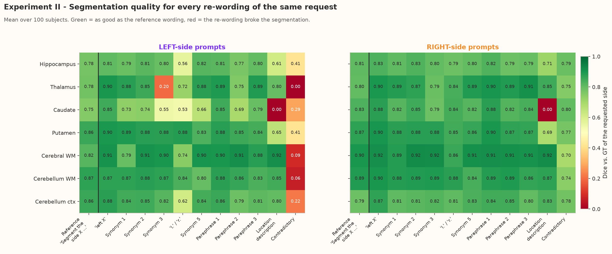

**In one paragraph:** Each cell is the accuracy (Dice) of one wording for one structure; the first column is the reference wording to compare against. The right-hand (right-side) panel is green almost everywhere except one cell — the caudate location description — so right-side requests survive nearly any rephrasing. The left-hand panel has many more yellow and red cells: the "l." abbreviation, "left thalamic nucleus", the caudate description and every contradictory prompt. The same words are used on both sides, so this difference is not about the vocabulary; it is the left side that is fragile.

**Main findings:**

- Right-side panel: green except the caudate location description (0.00).
- Left-side panel: failures for "l." (0.53–0.62), "left thalamic nucleus" (0.20), the caudate description (0.00) and all contradictions.
- Same vocabulary on both sides → the left side is intrinsically more fragile.

- Most synonyms and paraphrases stay **close to the reference** (typically Dice 0.79–0.91, within ~0.05 of the reference wording).
- Clear failures (red cells):
  - **Caudate location description** ("C-shaped basal ganglia nucleus bordering the left/right lateral ventricle") → **Dice 0.00 on both sides**: VoxTell cannot recognise the caudate from a description.
  - **"left thalamic nucleus"** → Dice **0.20**, while **"right thalamic nucleus"** → 0.79.
  - **"l." abbreviation** → Dice drops to 0.53–0.62 for caudate, hippocampus and cerebellum cortex; **"r."** stays at 0.79–0.88.
  - **Contradictory** prompts break the LEFT side only (as in Experiment I).

#### Left vs. right sensitivity — [`exp2_02_left_vs_right_wording_sensitivity.png`](plots/exp2_02_left_vs_right_wording_sensitivity.png)

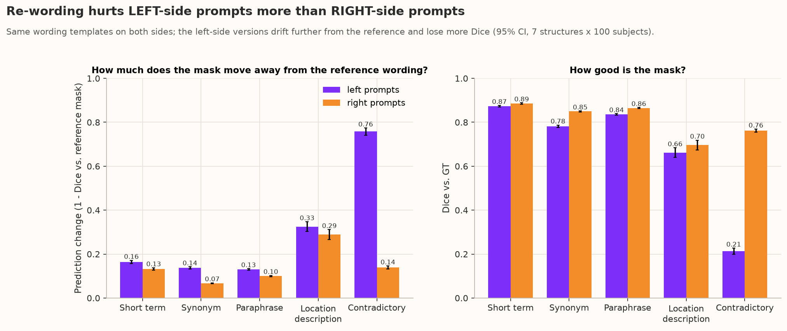

**In one paragraph:** This figure condenses the heat-map into prompt types and puts left (purple) and right (orange) next to each other. In the left panel (how far the mask moves from the reference) the purple bar is higher for every type — twice as high for synonyms and over five times as high for contradictions. In the right panel (accuracy) the purple bar is lower for every type. In other words, whatever kind of rephrasing you use, the left-side version is less stable and less accurate than the right-side version — another face of the same left/right asymmetry seen in Experiment I.

**Main findings:**

- Left prompts drift more from the reference for every prompt type.
- Synonyms: 0.14 (left) vs 0.07 (right); contradictions: 0.76 vs 0.14.
- Left prompts are less accurate for every type (overall Dice 0.74 vs 0.83).

The **same templates** are used on both sides, yet the left versions drift further from the reference mask for every prompt type:

| Prompt type | Prediction change, left | Prediction change, right |
|---|---:|---:|
| Short term | 0.16 | 0.13 |
| Synonym | **0.14** | **0.07** |
| Paraphrase | 0.13 | 0.10 |
| Location description | 0.33 | 0.29 |
| Contradictory | **0.76** | **0.14** |

Overall Dice vs. GT: **0.74 for left re-wordings vs 0.83 for right re-wordings.**

A telling detail: with `"l. caudate"` / `"l. hippocampus"` the mask **spills into the right hemisphere** (Dice with the *opposite* GT ≈ 0.47), i.e. VoxTell does not read "l." as "left" and falls back to a bilateral mask, whereas `"r."` is understood (opposite-side Dice 0.01).

#### Embedding distance vs. mask change — [`exp2_03_embedding_distance_vs_prediction_change.png`](plots/exp2_03_embedding_distance_vs_prediction_change.png) and [`exp2_04_correlation_by_structure.png`](plots/exp2_04_correlation_by_structure.png)

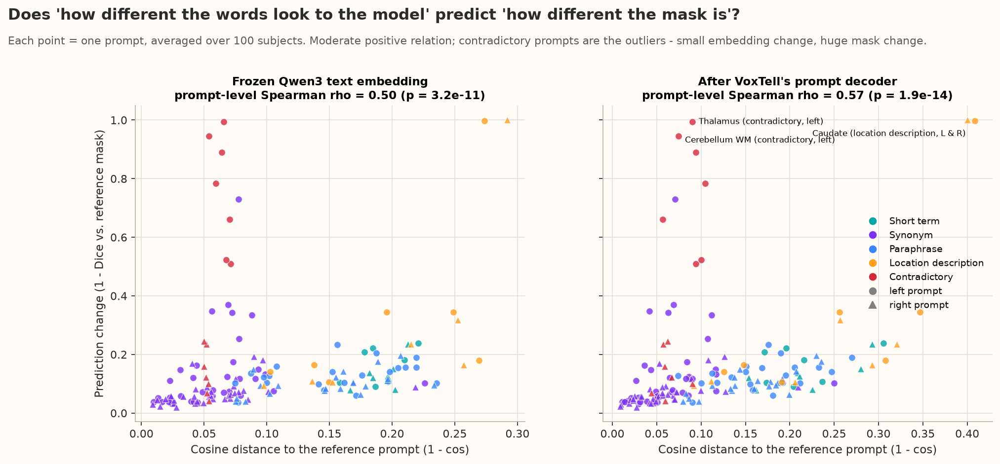
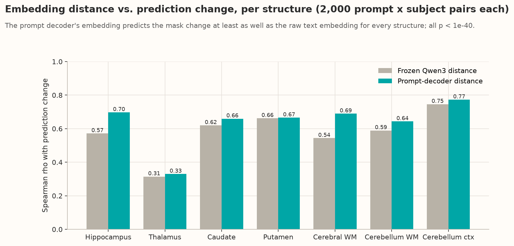

**In one paragraph:** The scatter plots ask whether "how different two prompts look to the model" predicts "how different their masks are". Points trend upwards — larger embedding distance, larger mask change — but with a lot of spread, and the relation is a bit tighter after VoxTell's own prompt decoder (ρ = 0.57) than in the raw Qwen3 embedding (ρ = 0.50). The red points (contradictions) break the pattern: they look like synonyms to the model (tiny distance) but change the mask the most. The bar chart repeats the test per structure and shows the prompt-decoder distance is the better predictor everywhere, with the weakest link for the thalamus (0.33) and the strongest for the cerebellum cortex (0.77). Practically, embedding distance can rank harmless re-wordings but cannot be used as a safety check for dangerous ones.

**Main findings:**

- Prompt-level Spearman ρ: 0.50 (Qwen3) and 0.57 (after prompt decoder).
- Per structure ρ = 0.31 (thalamus) to 0.77 (cerebellum cortex); prompt-decoder distance is better for all 7.
- Contradictions: tiny embedding distance (≈ 0.06), largest mask change → invisible to an embedding-based check.

- There is a **moderate positive relation**: prompts that move further in embedding space change the mask more (prompt-level Spearman ρ = **0.50** for Qwen3, **0.57** after the prompt decoder).
- Per structure (2,000 prompt×subject pairs each), ρ ranges from **0.31 (thalamus) to 0.77 (cerebellum cortex)**; the prompt-decoder distance is the better predictor for **all 7 structures**.
- **The exceptions matter most:** contradictory prompts have a *tiny* embedding distance (≈ 0.06, as small as a synonym) yet the largest mask change. Embedding distance cannot warn you about them.

#### The most disruptive wordings — [`exp2_05_most_disruptive_wordings.png`](plots/exp2_05_most_disruptive_wordings.png)

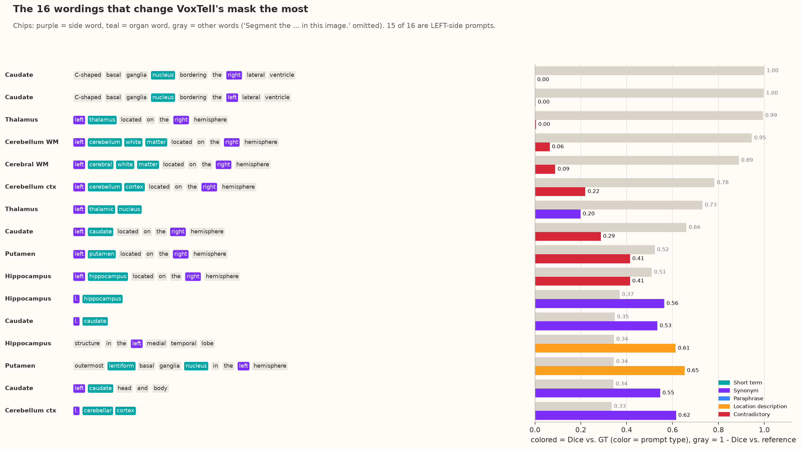

**In one paragraph:** This is a "hall of shame" of the 16 prompts that changed the mask most, written as word chips so you can see which words they contain. Three patterns stand out: (1) contradictions where "right" follows a left request, (2) wordings in which the structure name is replaced by a description or an unusual form ("C-shaped basal ganglia nucleus", "thalamic nucleus", "caudate head and body"), and (3) the abbreviation "l.". The coloured bar shows the remaining accuracy and the gray bar how far the mask moved. Only one of the 16 is a right-side prompt, and that one (the caudate description) fails on both sides.

**Main findings:**

- Three failure patterns: left request + later "right"; structure name replaced by a description/unusual form; the "l." abbreviation.
- 15 of 16 are left-side prompts; the only right-side one fails on both sides.

Word chips: purple = side word, teal = organ word, gray = other words. **15 of the 16 most disruptive prompts are left-side prompts**; the only right-side one is the caudate location description (which fails on both sides).

#### Example masks — [`exp2_06_example_masks_rewordings_0086.png`](plots/exp2_06_example_masks_rewordings_0086.png), [`exp2_06_example_masks_rewordings_0001.png`](plots/exp2_06_example_masks_rewordings_0001.png), [`exp2_06_example_masks_rewordings_0031.png`](plots/exp2_06_example_masks_rewordings_0031.png)

*The three example subjects were picked by their mean Dice on the plain base/left/right sentences in Experiment I: **OAS1_0086** is the median (typical) subject, **OAS1_0001** sits at the lower quartile, and **OAS1_0031** is the hardest of the 100 scans. Together they show what VoxTell does on a normal, a slightly worse and a difficult brain.*

**Subject OAS1_0086 (typical case — median subject)**

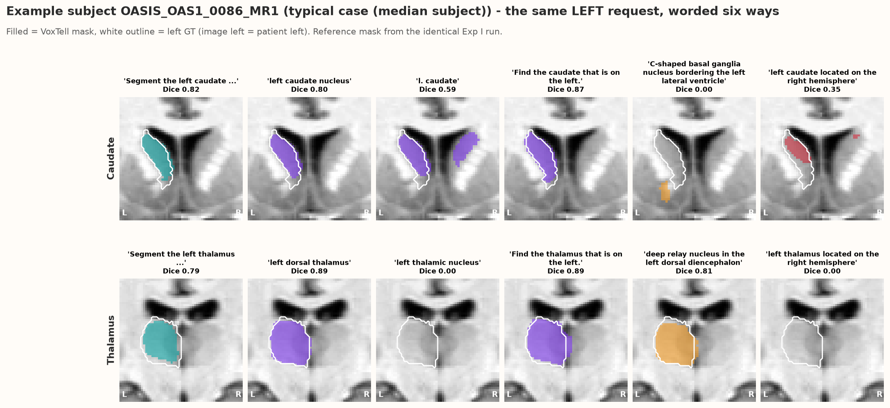

**Subject OAS1_0001 (lower-quartile subject)**

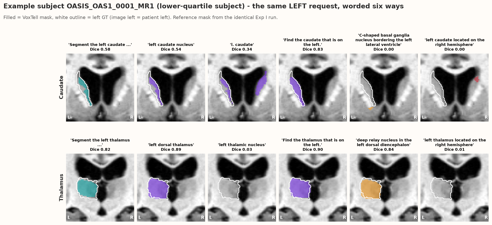

**Subject OAS1_0031 (hardest subject of the 100)**

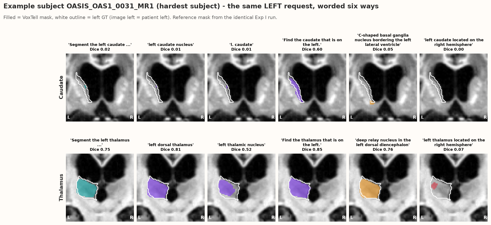

**Simple reading of the example masks (OAS1_0001):** Both rows show the same request — the *left* caudate (top) and the *left* thalamus (bottom) of one patient — written six different ways; the white outline is the real left structure. For the caudate, the reference sentence, "left caudate nucleus" and "Find the caudate that is on the left." fill the left outline, but "l. caudate" also colours the right caudate (VoxTell did not read "l." as "left"), the "C-shaped … nucleus" description finds only a small wrong blob below the structure, and the contradictory prompt puts a small blob on the right side. For the thalamus, most wordings work well (Dice 0.82–0.90), but "left thalamic nucleus" and the contradictory prompt return almost nothing. So in one patient you can see that harmless-looking word changes can completely change what VoxTell segments.

**Main findings:**

- **OAS1_0086 (typical):** most caudate wordings work well (reference 0.82, "left caudate nucleus" 0.80, paraphrase 0.87), but "l. caudate" drops to 0.59 and the C-shaped description finds nothing (0.00). For the thalamus every normal wording works (0.81–0.89) while "left thalamic nucleus" and the contradiction return nothing (0.00 / 0.00).
- **OAS1_0001 (lower quartile):** as described above — "l. caudate" spills into the right caudate (0.34), the description fails (0.00), "left thalamic nucleus" is almost empty (0.03).
- **OAS1_0031 (hardest):** almost every *left caudate* wording fails here — reference 0.02, "left caudate nucleus" 0.01, "l. caudate" 0.01, description 0.05 — only the paraphrase "Find the caudate that is on the left." partly recovers (0.60). The thalamus behaves better on this scan: "left thalamic nucleus" still reaches 0.52 and normal wordings 0.76–0.85; the contradiction fails (0.07).
- **Across all three subjects:** the same wordings fail in every patient (C-shaped description, contradiction), "left thalamic nucleus" fails in 2 of 3, and on the hardest scan the *left* request fails for nearly every wording — the left side is where VoxTell breaks first.

Subject OAS1_0001: `"l. caudate"` produces a bilateral caudate, the C-shaped description finds a small blob outside the caudate, and `"left thalamic nucleus"` returns an almost empty mask.

### A.4 Why?

- The frozen Qwen3 encoder places most synonyms very close to the reference (cosine distance ≈ 0.04–0.09), so VoxTell usually treats them the same — **robust to normal clinical synonyms**.
- **Descriptions without the structure name** (e.g. "C-shaped basal ganglia nucleus …") rely on anatomical reasoning that VoxTell's training (structure names → masks) never required.
- The **left side is more fragile** for the same reason as in Experiment I: the model has a right-leaning default. When the side cue is weak or unusual ("l.", "thalamic nucleus", a conflicting "right" later in the sentence), the left request is the one that breaks.

---

## Part B — Experiment III: where in VoxTell does the side information live?

**Part B in one paragraph:** Experiment III opens the model and measures, at each of its 14 processing stages, how far apart the internal representations of two prompts are. Comparing "left" vs "right" with "synonym" vs "reference" tells us where the side information lives. The side difference is present from the very first stage (the language model already encodes "left" and "right" differently) but it is small and of the same size as ordinary rephrasing until the text meets the image. In the U-Net fusion stages the side difference stays large while wording differences almost vanish, so the side becomes the dominant signal there. The same fusion stage is where the no-side prompt starts to resemble the "right" prompt, i.e. where the right-hemisphere bias is introduced.

**Main findings:**

- Side information is present from the first (text) stage but weak there.
- It becomes the dominant signal only in the U-Net fusion stages.
- The right-hemisphere bias is introduced at the first fusion stage.

### B.1 The question

VoxTell processes a prompt in 14 stages: frozen **Qwen3** text embedding → **projection** → 6 **prompt-decoder** (cross-attention) layers → **norm** → 5 **image-decoder fusion** stages (U-Net at 12³, 24³, 48³, 96³ and the final 192³ logits). At which stage do "left" and "right" become different, and is that difference bigger than the difference caused by mere re-wording?

### B.2 What was measured

For pairs of prompts on the same scan we computed the **cosine distance** (1 − cos) and relative L2 distance of their representations at each stage:
- **Left vs. Right**, **Base vs. Left**, **Base vs. Right** (side comparisons);
- **re-wording vs. reference** for synonyms, paraphrases, short terms, location descriptions and contradictions;
- for the 6 prompt-decoder layers also the distance between their **cross-attention maps** over the image.

### B.3 Results, figure by figure

#### Layer-wise trajectory — [`exp3_01_layerwise_distance_trajectory.png`](plots/exp3_01_layerwise_distance_trajectory.png)

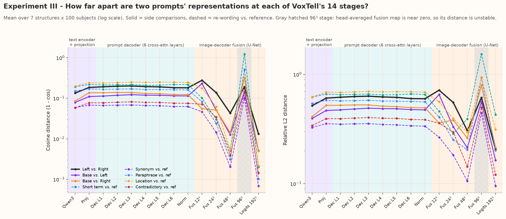

**In one paragraph:** Each line follows one kind of prompt pair through the network from left (text) to right (final mask); higher means the two prompts are represented more differently. In the purple and teal (text) zones, the solid black left-vs-right line sits among the dashed re-wording lines — the side word is just one more small difference. At the first orange (fusion) stage the black line jumps up to its highest value (0.28) while every dashed line falls, and from then on the black line stays above all re-wording lines all the way to the final mask. The gray hatched column (96³) is a numerical artefact and should be ignored.

**Main findings:**

- Text stages: left-vs-right (0.13–0.20) is comparable to re-wording distances.
- First fusion stage (12³): left-vs-right peaks (0.28) while re-wording distances drop.
- From then on, left-vs-right stays above every re-wording line; ignore the 96³ stage.

- **Text stages (Qwen3 → Norm):** Left vs. Right ≈ 0.13 → 0.20. This is about the same as a paraphrase (0.15–0.17) and *smaller* than the short-vs-sentence difference (0.19–0.22). In text space the side word is a **small** part of the representation.
- The 6 prompt-decoder layers barely change these distances (Left vs. Right peaks at 0.20 in layer 3 and drifts back to 0.18).
- **Fusion stages:** at the first fusion stage (12³) Left vs. Right jumps to its overall maximum (**0.28**) while every re-wording distance drops; after that all distances shrink (the image dominates), but re-wording distances shrink much faster than the left/right distance.
- The **96³ stage (gray hatch)** is numerically unstable: its head-averaged fusion map is close to zero, so cosine distances can exceed 1. Do not interpret it.

#### Side signal vs. wording noise — [`exp3_02_side_signal_vs_wording_noise.png`](plots/exp3_02_side_signal_vs_wording_noise.png)

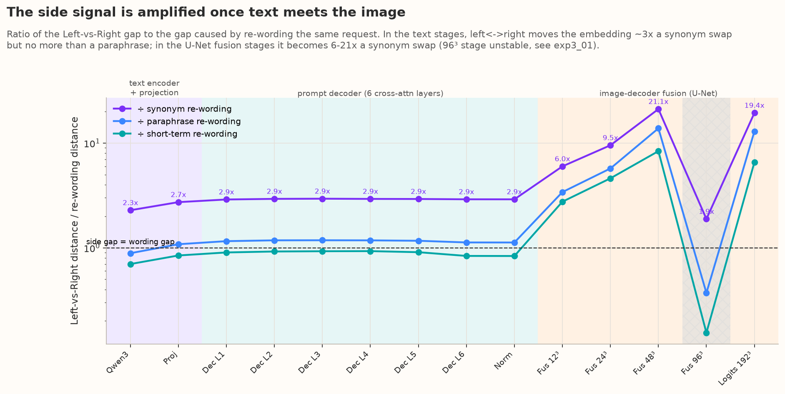

**In one paragraph:** This figure divides the left/right gap by the re-wording gap, so it reads like a signal-to-noise ratio: "how many times louder is the side word than a change of phrasing?". In the text stages the purple line is flat at about 3× a synonym swap (and about 1× a paraphrase — the dashed line), meaning the language model and prompt decoder treat a side change about as seriously as a rephrasing. After the text is fused with the image, the ratio climbs steeply to 6×, 9.5× and 21×, and stays at 19× in the final mask. VoxTell therefore turns a weak textual cue into a strong spatial decision only in its image decoder.

**Main findings:**

- Text stages: side gap ≈ 3× a synonym swap, ≈ 1× a paraphrase.
- Fusion stages: 6× (12³) → 9.5× (24³) → 21× (48³) → 19× (final logits).
- The image decoder converts a weak textual cue into a strong spatial decision.

The ratio *(Left-vs-Right distance) / (re-wording distance)* tells us how much louder the side signal is than the wording noise:
- text stages: **2.3–2.9×** a synonym swap, **≈ 1×** a paraphrase;
- 12³ fusion: **6×**, 24³: **9.5×**, 48³: **21×**, final logits: **19×**.

This amplification holds for **every one of the 7 structures individually** (e.g. 48³ stage: 15–62× per structure). → *The side is decided where text meets image, not in the language model.*

#### Where does the no-side prompt pick a hemisphere? — [`exp3_03_base_prompt_side_lean_by_stage.png`](plots/exp3_03_base_prompt_side_lean_by_stage.png)

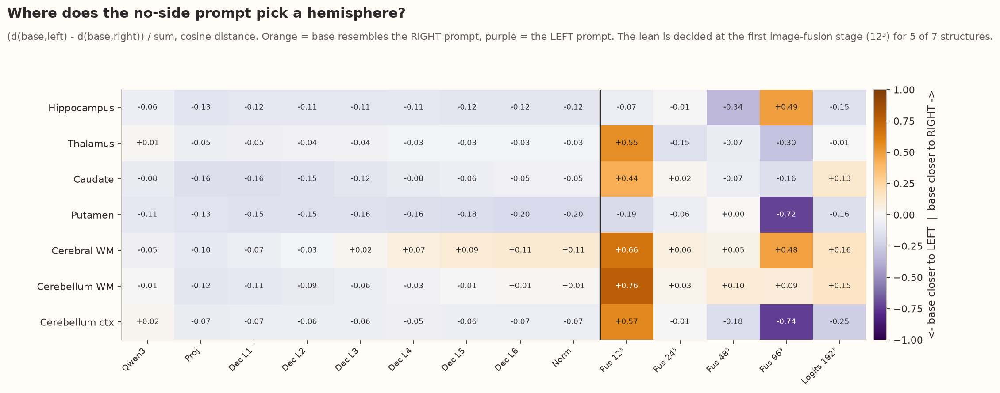

**In one paragraph:** Each cell asks: "at this stage, does the no-side prompt look more like the left prompt (purple) or the right prompt (orange)?". The whole text part of the map is pale — the no-side prompt is roughly neutral, if anything slightly closer to "left". Then, at the vertical black line where the image is fused in, five structures turn clearly orange (thalamus, caudate, cerebral white matter, cerebellum white matter, cerebellum cortex). These are exactly the structures whose base-sentence masks favoured the right hemisphere in Experiment I, while the putamen — the one structure that leaned left there — stays purple here as well. This match between internal representation and output behaviour pinpoints the fusion stage as the origin of the bias.

**Main findings:**

- Text stages: the no-side prompt is roughly neutral (−0.20 to +0.11).
- 12³ fusion: 5 of 7 structures turn towards "right" (+0.44 to +0.76).
- The same 5 structures lean right in Experiment I's outputs; putamen leans left in both.

Orange = the base prompt resembles the RIGHT prompt; purple = the LEFT prompt.
- In the **text stages**, the base prompt is close to neutral (values between −0.20 and +0.11, mostly slightly closer to *left*).
- At the **first image-fusion stage (12³)** it jumps towards *right* for **5 of 7 structures** (thalamus +0.55, caudate +0.44, cerebral WM +0.66, cerebellum WM +0.76, cerebellum cortex +0.57). Putamen (−0.19) and hippocampus (−0.07) do not.
- This matches Experiment I exactly: the same 5 structures segment more of the right side with the base sentence, putamen leans left, hippocampus is balanced.

→ **The right-hemisphere bias is created at the text-image fusion bottleneck, not in Qwen3.**

#### Cross-attention — [`exp3_04_cross_attention_difference_by_layer.png`](plots/exp3_04_cross_attention_difference_by_layer.png)

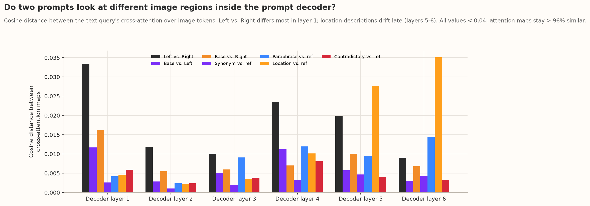

**In one paragraph:** Inside the prompt decoder, the text query "looks at" the image through cross-attention. If left and right prompts looked at different hemispheres here, the bars would be large. They are tiny (all below 0.04, i.e. the attention maps are more than 96 % identical); the black left-vs-right bar is largest only in the first layer. The prompt decoder therefore does not decide the side by looking at a different part of the image — the side is carried inside the query vector and only acted upon later by the image decoder.

**Main findings:**

- All cross-attention differences < 0.04 → attention maps > 96 % identical.
- Left-vs-right differs most in layer 1; location descriptions drift in layers 5–6.
- The side is carried in the query vector, not by attending to a different hemisphere.

The prompt decoder's attention maps over the image are > 96 % similar for every pair (all distances < 0.04). Left vs. Right differs most in **layer 1** (0.033); location descriptions drift in the **last layers** (5–6). The prompt decoder therefore does not "look" at a different hemisphere for left vs. right — the side information is carried in the query vector and resolved in the image decoder.

#### Per-structure view — [`exp3_05_left_right_gap_by_structure.png`](plots/exp3_05_left_right_gap_by_structure.png)

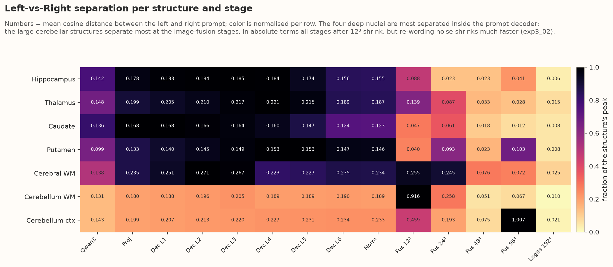

**In one paragraph:** This heat-map breaks the left-vs-right gap down by structure (rows) and stage (columns), with the colour scaled per row so you can see where each structure's gap is largest. For the small deep nuclei (hippocampus, thalamus, caudate, putamen) the darkest cells are inside the prompt decoder, while for the large cerebellar structures they are at the first fusion stages (cerebellum white matter reaches 0.92 at 12³). For every structure the gap remains clearly non-zero all the way to the final mask, so side information is never lost — it is only compressed together with everything else as the mask is drawn.

**Main findings:**

- Deep nuclei: largest gap inside the prompt decoder.
- Cerebellar structures: largest gap at the first fusion stages (cerebellum WM 0.92 at 12³).
- The gap never reaches zero — side information is never lost.

The four deep nuclei (hippocampus, thalamus, caudate, putamen) have their largest absolute left/right gap inside the prompt decoder; the large cerebellar structures peak at the fusion stages (cerebellum WM 0.92 at 12³).

### B.4 Why?

VoxTell's text side is a general-purpose LLM embedding in which "left" vs. "right" is one small direction among many. The image decoder, however, has to put the mask somewhere in 3D space, so at the fusion stages the representation is dominated by *where* the query matches the image. Synonyms all match the same place (their distance collapses), while left and right match different hemispheres (their distance survives) — that is why the ratio grows. Because the base prompt has no side direction, its location at the fusion stage is decided by small asymmetries in the learned query → it lands closer to "right".

---

## Limitations

- Distances are averaged over pooled 6×6×6 summaries at the fusion stages; fine spatial detail is lost.
- The 96³ fusion stage is unreliable (head-averaged map ≈ 0).
- One reference template per side; synonyms were hand-written (5 per side and structure).
- Correlations are across prompts and subjects pooled per structure; they do not prove causation (Experiment V tests causation by ablation).

## Answers to the research questions

| # | Question / expectation | What we found | Answer |
|---|---|---|---|
| **G1** | Synonyms give the same mask and accuracy | Synonyms: mask change 0.10, Dice drop vs reference only 0.01; paraphrases even slightly better than the reference. Fails for descriptions without the name (caudate Dice 0.00), "l.", "left thalamic nucleus" | ✅ **Mostly**, ⚠️ with specific, mostly left-sided exceptions |
| **G2** | Bigger embedding shift → bigger mask shift | Prompt-level ρ = 0.50 (Qwen3) / 0.57 (prompt decoder); per structure 0.31–0.77, all p < 1e-40. Contradictions are the outliers | ⚠️ **Moderate link** — real but not reliable enough to predict failures |
| **G3** | Output ranking follows embedding ranking | Within each subject/structure/side, Spearman between the distance rank and mask-change rank averages **0.52** (Qwen3) and **0.58** (prompt decoder); prompt-decoder ranking agrees positively in 99.6 % of groups | ✅ **Yes, moderately** |
| **G4** | Similarity maps stay the same across synonyms | Correlation with the reference similarity map: synonyms 0.97, paraphrases 0.96, contradictory 0.93, short term 0.91, location description 0.90 | ✅ **Yes** for synonyms; descriptions drift most |
| **G5** | Where does the left/right gap appear? | Already in the frozen Qwen3 embedding (0.13), slightly growing through the projection and prompt decoder (≈ 0.18–0.20) | **At the very first stage (text encoder)** — but only as a weak signal |
| **G6** | Where does it collapse? | It never collapses relative to wording noise: maximum at the 12³ fusion stage (0.28), and still 19× a synonym swap at the final logits | **It is not lost** — it is amplified in the image decoder |
| **G7** | Side gap vs. wording gap | ≈ 3× a synonym and ≈ 1× a paraphrase in text stages; 6–21× a synonym in fusion stages | **Side becomes dominant only after text–image fusion** |

**In one paragraph:** VoxTell mostly treats synonyms as the same concept, and the size of a wording change inside the model loosely predicts the size of the mask change, so the model is neither ignoring wording nor wildly over-reacting to it. The exceptions are informative: almost all harmful re-wordings are left-sided, and contradictions are invisible in embedding space but devastating in the output. The layer analysis shows why both happen. Side information enters at the very first (text) stage but is weak there — comparable to a paraphrase — so unusual wording can blur it. It is only in the U-Net fusion that the side becomes the dominant signal, and that is also the stage where the no-side prompt is pulled towards "right". Any fix for VoxTell's laterality bias should therefore target the text–image fusion, not the language model.

**Main findings:**

- Synonyms ≈ same concept (G1 ✅ mostly), with left-sided exceptions.
- Embedding change ↔ mask change: moderate (G2 ⚠️), ranking agreement ρ ≈ 0.52–0.58 (G3 ✅).
- Similarity maps stay similar (0.90–0.97, G4 ✅).
- Side enters at the text encoder (G5), is never lost (G6), and dominates only after fusion (G7).
- Fixes for the laterality bias should target the text–image fusion.

## Verdict

| Question | Answer |
|---|---|
| Is VoxTell robust to clinical synonyms and paraphrases? | **Mostly yes** (prediction change ≈ 0.10, Dice ≈ 0.82–0.85) — **except** descriptions without the structure name, the abbreviation "l.", and "left thalamic nucleus". |
| Is it equally robust on both sides? | **No.** Left-side re-wordings change the mask about **2× more** than right-side ones (0.21 vs 0.11) and lose ~0.09 Dice; 15 of the 16 most disruptive prompts are left-sided. |
| Does embedding distance predict the mask change? | **Moderately** (ρ ≈ 0.5–0.6; prompt-decoder distance is better than raw Qwen3). It **misses contradictory prompts** completely. |
| Where is laterality resolved? | **In the image-decoder fusion stages.** In text space left/right is no bigger than a paraphrase; after fusion it is 6–21× larger than a synonym swap. |
| Where does the right-hemisphere bias come from? | **The first fusion stage (12³)**, where the side-less prompt is pulled towards the "right" representation for 5 of 7 structures. |
