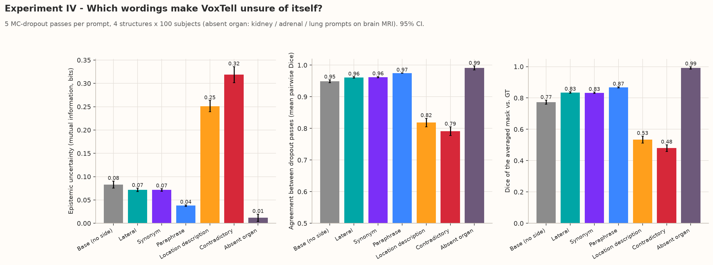
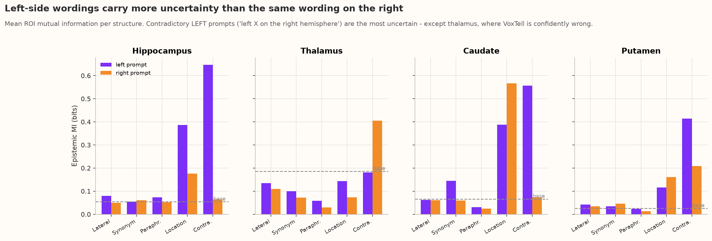
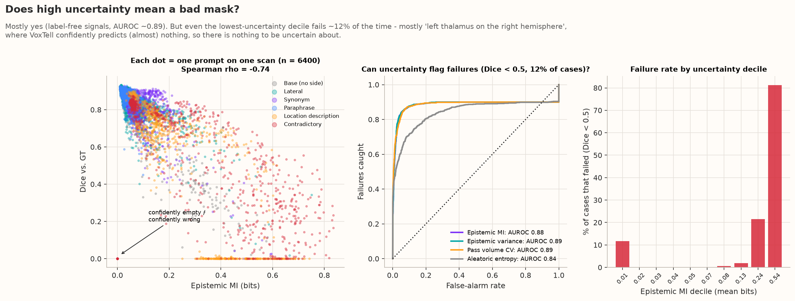
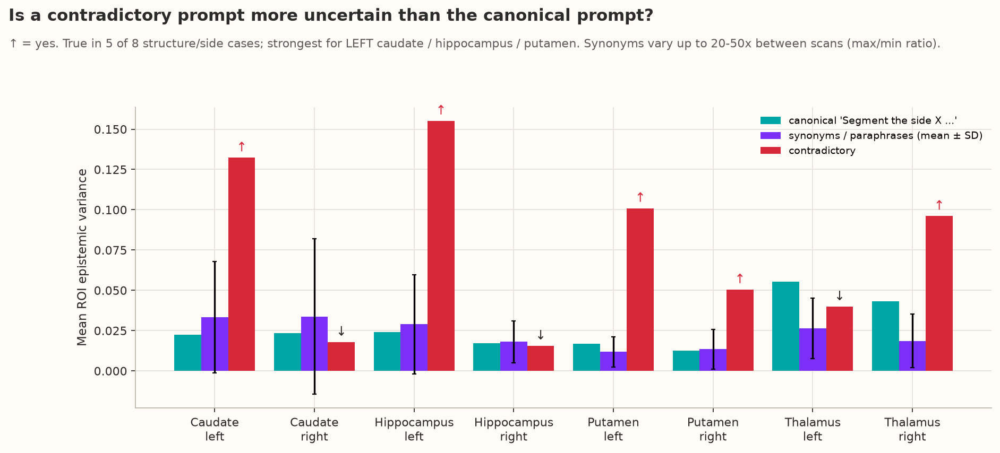
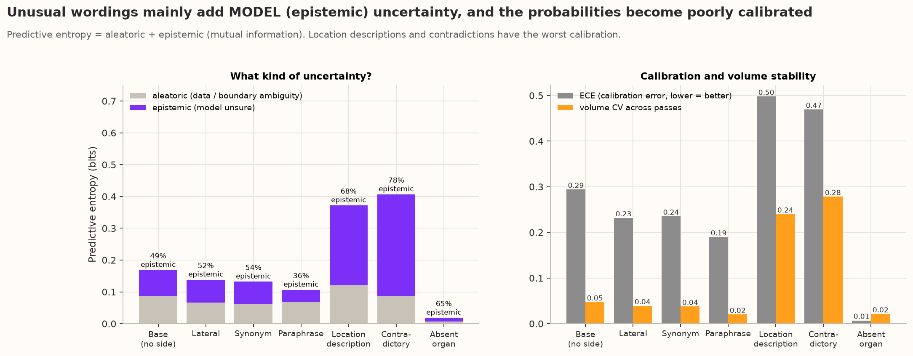
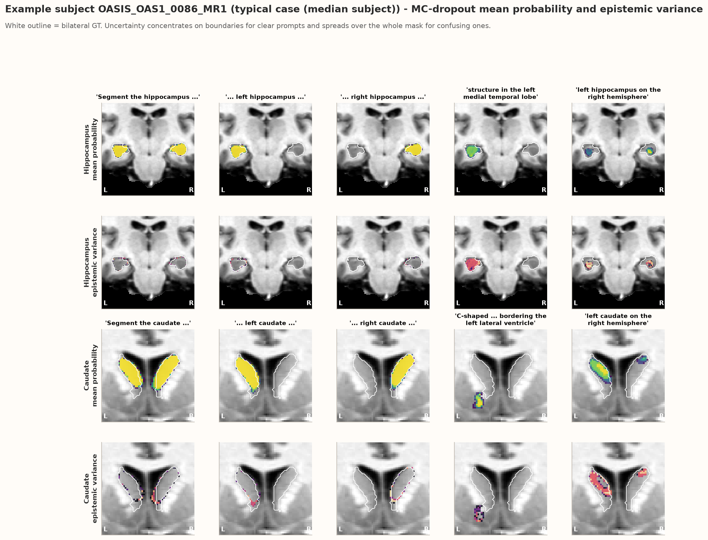
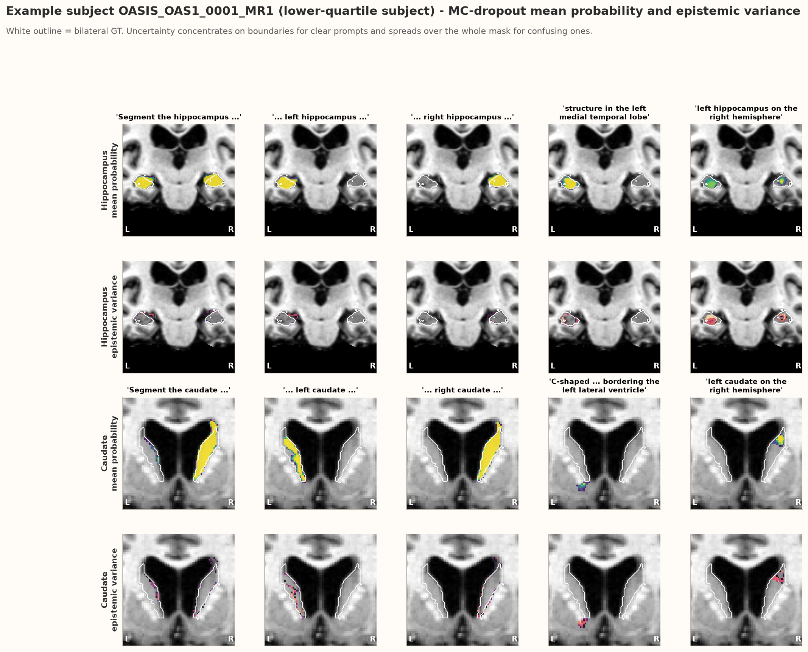
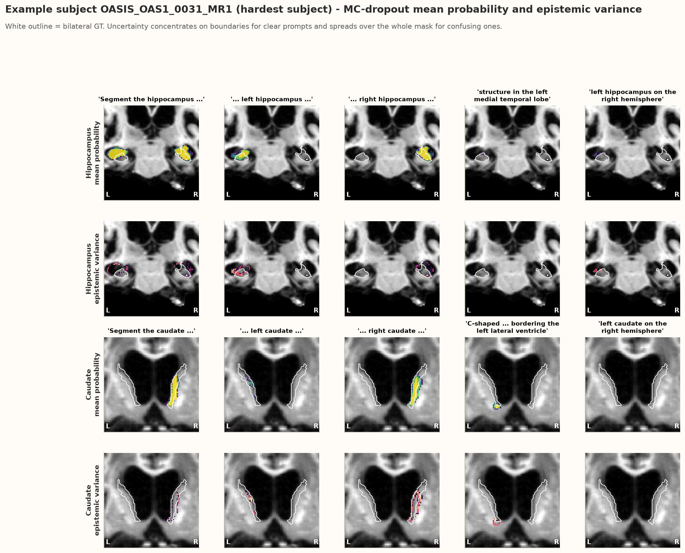

# Experiment IV — MC-Dropout uncertainty: does VoxTell *know* when a prompt confuses it?

**Folder:** `results_axis2_exp4/` · **Raw outputs:** `exp4_mc_dropout_uncertainty/` · **Figures:** [`plots/`](plots/) · **Script:** `analysis/plot_axis2_exp4.py`

---

## 0. Research goal — what we were looking for

From the Axis II plan (*"How stable is the model to wording?"*), MC-dropout uncertainty was used to check:

| # | Question | What would indicate a problem |
|---|---|---|
| **G1** | How does uncertainty compare across prompt variants (canonical, synonym, paraphrase, location, contradictory, absent organ)? | Large uncertainty for wordings that mean the same thing |
| **G2** | Do **synonyms of the same concept** give similar uncertainty? | Very different uncertainty for synonyms → the model is **unstable to wording** |
| **G3** | Are **contradictory** prompts (wrong side) more uncertain than correct ones? | If not → the model is **not aware of the mismatch** |
| **G4** | Which kind of uncertainty dominates — epistemic (model doesn't know) or aleatoric (ambiguous input)? | Epistemic dominance for odd wordings means the problem lies in the model's handling of text |
| **G5** | (added) Can uncertainty serve as a label-free **warning signal** for bad masks? | Low AUROC → uncertainty is not useful in practice |

The answers are collected in **Section 5b** below.

## The whole experiment in one paragraph

We switched on VoxTell's dropout at test time and ran each prompt 5 times on 100 brain MRIs (4 structures, 69 prompts per scan, 6,900 evaluations) to see how much the masks disagree — a measure of how sure the model is about what the prompt means. For ordinary prompts (canonical, short, synonyms, paraphrases) VoxTell is confident and consistent: the 5 masks agree with Dice ≈ 0.96 and the epistemic uncertainty is low (≈ 0.04–0.08 bits). Anatomical location descriptions and contradictory prompts are 3–4× more uncertain (0.25 and 0.32 bits), their 5 masks agree much less (Dice ≈ 0.8), most of their uncertainty is epistemic (68–78 %), and their probabilities are badly calibrated (ECE ≈ 0.5). Left-side prompts are about 1.5× more uncertain than right-side ones, again pointing at the fragile left side. Uncertainty is a good label-free failure detector (Spearman −0.74 with Dice, AUROC ≈ 0.89), but it has a blind spot: when VoxTell returns an almost empty mask — most notably for "left thalamus located on the right hemisphere" — it is *confidently* wrong, so uncertainty alone does not catch it. Absent organs are rejected with near-zero uncertainty.

**Main findings:**

- Ordinary prompts: confident and consistent (inter-pass Dice ≈ 0.96, MI 0.04–0.08 bits).
- Location descriptions and contradictions: 3–4× more uncertain (0.25 / 0.32 bits), masks disagree (inter-pass Dice ≈ 0.8).
- The extra uncertainty is mostly epistemic (68–78 %) and poorly calibrated (ECE ≈ 0.5).
- Left prompts ≈ 1.5× more uncertain than right prompts.
- Uncertainty flags failures well (ρ = −0.74, AUROC ≈ 0.89) but misses confidently-empty masks.
- Absent organs are rejected with near-zero uncertainty.

## 1. The question in plain words

Experiments I–II showed that some wordings (contradictions, anatomical descriptions, left-side variants) produce bad masks. A safe model should at least be **unsure** in those cases, so that a user or a pipeline can be warned.
We ask:
1. Which prompt types make VoxTell uncertain?
2. Is the uncertainty larger for left-side prompts than right-side ones?
3. Can uncertainty — which needs no ground truth — **flag the bad masks**?

## 2. What was run

| Item | Value |
|---|---|
| Method | **Monte-Carlo (MC) dropout**: dropout layers are switched on at test time and the same prompt is run **5 times**; differences between the 5 runs measure the model's uncertainty |
| Where the randomness is | VoxTell's dropout lives in the **prompt (transformer) decoder**; the image encoder is deterministic. So this measures how *stable the text-to-image query* is |
| Data | 100 Neurite-OASIS MRIs |
| Structures | 4 (hippocampus, thalamus, caudate, putamen) — reduced from 7 to fit the Kaggle time budget |
| Prompts | 69 per scan: base, lateral (sentence + short), 2 synonyms, 1 paraphrase, 1 location description, 1 contradictory — for each side — plus 5 absent-organ prompts. 6,900 evaluations in total |

**Uncertainty measures (all computed inside the predicted region = voxels any pass called foreground):**

| Name | Meaning |
|---|---|
| **Epistemic uncertainty** (mutual information, MI, in bits; and variance) | "The model is unsure": the 5 passes disagree |
| **Aleatoric uncertainty** (mean per-pass entropy) | "The data is ambiguous": each pass itself gives probabilities near 0.5 (typically at boundaries) |
| **Inter-pass Dice** | How similar the 5 masks are to each other (1 = identical) |
| **Volume CV** | How much the mask volume varies between passes |
| **ECE** | Calibration error: do 80 %-confident voxels turn out right 80 % of the time? (needs GT; lower = better) |

## 3. Results, figure by figure

### 3.1 Uncertainty by prompt type — [`exp4_01_uncertainty_by_prompt_type.png`](plots/exp4_01_uncertainty_by_prompt_type.png)

**In one paragraph:** The three panels show, for each prompt type, how unsure VoxTell is (left), how similar its 5 dropout masks are to each other (middle) and how good the averaged mask is (right). The four "normal" types on the left of each panel look alike: low uncertainty, almost identical masks, good Dice. The orange (location description) and red (contradictory) bars stand out in all three panels at once — high uncertainty, disagreeing masks, low Dice. This alignment is the key message: the prompts that produce bad masks are also the prompts that make the model visibly unsure, so uncertainty carries real information about prompt problems.

**Main findings:**

- Normal wordings: low uncertainty, near-identical passes, good Dice.
- Location / contradictory: high uncertainty, disagreeing passes, low Dice — all at once.
- Uncertainty tracks the same prompts that cause bad masks.

| Prompt type | Epistemic MI (bits) | Inter-pass Dice | Dice vs GT |
|---|---:|---:|---:|
| Base (no side) | 0.08 | 0.95 | 0.77 |
| Lateral | 0.07 | 0.96 | 0.83 |
| Synonym | 0.07 | 0.96 | 0.83 |
| Paraphrase | 0.04 | 0.97 | 0.87 |
| **Location description** | **0.25** | **0.82** | **0.53** |
| **Contradictory** | **0.32** | **0.79** | **0.48** |
| Absent organ | 0.01 | 0.99 | 0.99* |

\*For absent organs "Dice 1" means *correctly empty*.

Ordinary wordings give low, similar uncertainty. Location descriptions and contradictions are **3–4× more uncertain** and the 5 passes disagree noticeably (inter-pass Dice ≈ 0.8). Absent organs are confidently rejected.

### 3.2 Left vs. right — [`exp4_02_left_vs_right_uncertainty_by_structure.png`](plots/exp4_02_left_vs_right_uncertainty_by_structure.png)

**In one paragraph:** Each small panel is one structure; purple bars are left-side prompts and orange bars the same wording on the right, with the dashed line marking the no-side prompt. For ordinary wordings (lateral, synonym, paraphrase) the bars are low and similar, but whenever a wording is "hard" (location description, contradiction), the purple bar is usually far higher — for the hippocampus the left contradiction is ten times as uncertain as the right one. The thalamus is the visible exception: its left contradiction is *not* very uncertain, because VoxTell confidently outputs nothing there. Overall the figure shows that the left side is not only less accurate (Experiments I–II) but also less certain.

**Main findings:**

- Hard wordings are usually far more uncertain on the left (hippocampus contradiction ≈ 10× the right one).
- Thalamus left contradiction is the exception: confidently empty, not uncertain.
- The left side is both less accurate and less certain.

Averaged over everything, **left prompts have 1.5× the epistemic uncertainty of right prompts** (MI 0.15 vs 0.10) and lower Dice (0.69 vs 0.80).
The largest gaps are the **contradictory LEFT prompts** for hippocampus, caudate and putamen. Two exceptions are informative:
- **Thalamus:** "left thalamus located on the right hemisphere" is *less* uncertain than the right version, although its Dice is ≈ 0 → VoxTell is **confidently empty** (see 3.3).
- **Caudate / putamen location descriptions** are more uncertain on the right. The caudate description fails on both sides (Dice ≈ 0, Experiment II); the putamen one is mediocre on both (Dice 0.63 left / 0.69 right).

### 3.3 Does uncertainty flag failures? — [`exp4_03_uncertainty_predicts_failure.png`](plots/exp4_03_uncertainty_predicts_failure.png)

**In one paragraph:** The left panel plots each prompt-on-scan case as a dot: the further right (more uncertain), the lower the Dice tends to be, giving a clear downward cloud. The middle panel turns this into a detector: if we flag masks whose uncertainty is above a threshold, we can catch about 85–90 % of the failed masks while raising few false alarms (AUROC ≈ 0.89). The right panel shows the failure rate per uncertainty decile — almost zero in the middle, 81 % in the top decile — but also a surprising 12 % failure rate in the *lowest* decile. Those are the "confidently empty" cases (dots at Dice 0 on the far left of the scatter), which is why a simple "mask too small" check should be used together with uncertainty.

**Main findings:**

- More uncertainty → lower Dice (ρ = −0.74).
- Thresholding uncertainty catches ~85–90 % of failures (AUROC ≈ 0.89).
- Top decile: 81 % failures; lowest decile: still 12 % failures (confidently empty).
- Combine uncertainty with a "mask too small" check.

- Across 6,400 prompt × scan cases, epistemic MI and Dice are strongly anti-correlated (**Spearman ρ = −0.74**).
- As a failure detector (failure = Dice < 0.5, 12 % of cases) the label-free signals reach **AUROC ≈ 0.89** (MI, variance and pass-volume CV); aleatoric entropy alone reaches 0.84.
- Failure rate rises from 0 % in the middle deciles to **81 %** in the most uncertain decile.
- **But:** the ROC curves plateau at ~90 % of failures caught, and the *least* uncertain decile still contains **12 % failures**. Almost all of them (70 of 75) are "left thalamus located on the right hemisphere": the model outputs (almost) nothing in every pass, so there is nothing to disagree about.

### 3.4 Contradictory vs. canonical — [`exp4_04_contradictory_vs_canonical_uncertainty.png`](plots/exp4_04_contradictory_vs_canonical_uncertainty.png)

**In one paragraph:** For each structure and side, the teal bar is the canonical prompt, the purple bar the average of its synonyms/paraphrases and the red bar the contradictory prompt; an upward arrow means the contradiction is more uncertain than the canonical prompt. In 5 of 8 cases it is — and very clearly for the left caudate, left hippocampus and left putamen (4–6.5×). In the three "↓" cases VoxTell either quietly resolved the contradiction to the side named before the organ (right caudate, right hippocampus — both give normal right masks in Experiment I) or confidently produced nothing (left thalamus). The purple bars sit close to the teal ones on average, so synonyms do not systematically change uncertainty, although their spread between scans is large.

**Main findings:**

- Contradiction more uncertain than canonical in 5 of 8 cases (4–6.5× for left caudate, hippocampus, putamen).
- Not more uncertain when VoxTell silently resolves it (right caudate / hippocampus) or outputs nothing (left thalamus).
- Synonyms ≈ canonical on average, but vary strongly between scans.

Contradictory prompts are more uncertain than the canonical prompt in **5 of 8** structure/side combinations. The increase is **4–6.5×** for left caudate, left hippocampus, left putamen and right putamen. Synonyms show a wide spread between scans (max/min variance ratio 20–50×), so uncertainty is also scan-dependent.

### 3.5 What kind of uncertainty, and is it calibrated? — [`exp4_05_uncertainty_decomposition_and_calibration.png`](plots/exp4_05_uncertainty_decomposition_and_calibration.png)

**In one paragraph:** The left panel splits each bar of total uncertainty into an image-related part (gray, "aleatoric": unclear boundaries) and a model-related part (purple, "epistemic": the model is unsure of its interpretation). The gray part is about the same for every prompt type, because the images are the same; the purple part is what grows for location descriptions and contradictions. So the extra uncertainty comes from the model struggling with the *text*, not from the anatomy. The right panel shows that for these same prompts the predicted probabilities are least trustworthy (calibration error about twice as high) and the mask volume varies most between passes.

**Main findings:**

- Aleatoric (image) part is roughly constant across prompt types.
- Epistemic (model) part grows for location descriptions and contradictions.
- Those prompts also have the worst calibration (ECE ≈ 0.5) and most unstable volume.

- For normal prompts roughly half of the predictive entropy is epistemic (36–54 %); for location descriptions and contradictions it rises to **68 % and 78 %**. Confusing wording mainly makes the **model** unsure, not the image.
- Calibration (ECE) is moderate for normal prompts (0.19–0.29) and **poor for location descriptions (0.50) and contradictions (0.47)**: the probabilities overstate confidence exactly when the prompt is problematic.

### 3.6 Uncertainty maps — [`exp4_06_example_uncertainty_maps_0086.png`](plots/exp4_06_example_uncertainty_maps_0086.png), [`exp4_06_example_uncertainty_maps_0001.png`](plots/exp4_06_example_uncertainty_maps_0001.png), [`exp4_06_example_uncertainty_maps_0031.png`](plots/exp4_06_example_uncertainty_maps_0031.png)

*The three example subjects were picked by their mean Dice on the plain base/left/right sentences in Experiment I: **OAS1_0086** is the median (typical) subject, **OAS1_0001** sits at the lower quartile, and **OAS1_0031** is the hardest of the 100 scans. Together they show what VoxTell does on a normal, a slightly worse and a difficult brain.*

**Subject OAS1_0086 (typical case — median subject)**

**Subject OAS1_0001 (lower-quartile subject)**

**Subject OAS1_0031 (hardest subject of the 100)**

**Simple reading of the example masks (OAS1_0001):** For one patient, the first and third rows show how strongly VoxTell believes each voxel belongs to the structure (yellow = very sure, dark = unsure), and the second and fourth rows show where its 5 dropout runs disagree (bright = disagreement); the white outline is the real structure. With clear prompts (first three columns) the structure is solid yellow and disagreement is only a thin line along the edge — the model is sure, except about the exact border. With the location description and the contradictory prompt (last two columns), the yellow fades to green/blue (probabilities near 0.5) and the disagreement fills the whole predicted region, for the hippocampus even on both sides. For the caudate description, the small wrong blob below the caudate is itself bright in the disagreement map — so the uncertainty map literally highlights the mistake.

**Main findings:**

- **OAS1_0086 (typical):** clear prompts are solid yellow with only a thin uncertain rim (MI 0.06–0.11 bits, Dice 0.78–0.85). The location description (MI 0.60) and the hippocampus contradiction (MI 0.70, Dice 0.09) show faded probabilities and uncertainty spread over the predicted region; the caudate contradiction is uncertain (MI 0.63) and only partially correct (Dice 0.31).
- **OAS1_0001 (lower quartile):** as described above — boundary-only uncertainty for clear prompts, whole-region uncertainty for the description and the contradiction (MI 0.25–0.71).
- **OAS1_0031 (hardest):** even clear prompts are less certain (hippocampus MI 0.17–0.30 vs ≈ 0.07 elsewhere). The plain "left caudate" prompt nearly fails (Dice 0.02) but is flagged — MI **0.66**, ten times the right caudate's uncertainty. The "left caudate on the right hemisphere" prompt, however, outputs **nothing with MI 0.00** — a textbook confidently-empty failure that uncertainty cannot catch.
- **Across all three subjects:** clear prompts → uncertainty only on edges; confusing prompts → uncertainty fills the mask; and empty failures stay invisible to uncertainty. The harder the scan, the higher the baseline uncertainty.

Subject OAS1_0001. For clear prompts, uncertainty (bottom rows) is a thin rim on the boundary. For "left hippocampus on the right hemisphere" the probability drops to ~0.5 and uncertainty fills **both** hippocampi; for the caudate location description, the small wrong blob below the caudate is itself highly uncertain.

## 4. Why is this happening?

- MC dropout perturbs the **prompt decoder**. If the text query is clear, small perturbations do not change where it matches the image → low epistemic uncertainty. If the query sits between two interpretations (left vs right, caudate vs some other nucleus), small perturbations flip the match → high epistemic uncertainty.
- The **left side is more fragile** (Experiments I–III), so its queries sit closer to such decision boundaries → more uncertainty.
- **"Confidently empty" failures** happen when the query matches nothing strongly enough in *any* pass. Uncertainty is measured where the model predicts something, so an empty prediction looks "certain".

## 5. Limitations

- Only **5 passes** (10 would give smoother variance estimates) and **4 structures**, chosen to fit Kaggle's 12-hour limit.
- Dropout exists only in the prompt decoder; image-side uncertainty (e.g. scan quality) is not captured.
- ECE and Dice need GT; only MI / variance / volume CV are usable at deployment.
- ROI-based metrics are undefined-ish for empty predictions (they fall back to low-probability voxels), which is part of why confidently-empty failures are missed.

## 5b. Answers to the research questions

| # | Question | What we found | Answer |
|---|---|---|---|
| **G1** | Uncertainty across prompt variants | Canonical / short / synonym / paraphrase: MI 0.04–0.08 bits, inter-pass Dice 0.95–0.97. Location: 0.25, contradictory: 0.32 bits (inter-pass Dice ≈ 0.8). Absent organ: 0.01 | **Ordinary wordings are stable; descriptive and contradictory wordings are 3–4× more uncertain** |
| **G2** | Do synonyms give similar uncertainty? | On average yes — synonym mean variance is within ~0.4–1.5× of the canonical prompt for every structure/side — but between scans it varies 20–50× (max/min ratio) | ✅ **Stable on average**, ⚠️ scan-dependent |
| **G3** | Are contradictory prompts more uncertain? | Yes in 5 of 8 structure/side cases (4–6.5× for left caudate, hippocampus, putamen). No for right caudate / right hippocampus (contradiction silently resolved) and left thalamus (confidently empty) | ⚠️ **Partly aware** — VoxTell notices some contradictions but not all |
| **G4** | Epistemic or aleatoric? | Epistemic share 36–54 % for ordinary prompts, **68 % (location)** and **78 % (contradictory)**; aleatoric part roughly constant | **Epistemic** — the extra uncertainty comes from how the model reads the text |
| **G5** | Useful as a warning signal? | Spearman −0.74 with Dice; AUROC ≈ 0.89 for MI, variance and volume CV; misses confidently-empty failures | ✅ **Yes, with an empty-mask check** |

**In one paragraph:** VoxTell is stable to everyday rephrasing — synonyms and paraphrases neither change the masks nor make the model less sure. It becomes unstable when the text does not name the structure or contradicts itself, and in that case the instability is mostly *epistemic*, i.e. it comes from the model's interpretation of the prompt rather than from the image. VoxTell is only partly "aware" of contradictions: it is uncertain about most left-side contradictions, but it either silently resolves the right-side ones or confidently produces nothing (left thalamus). In practice, MC-dropout uncertainty is a strong, label-free way to flag prompt-induced failures, provided it is combined with a check for empty or implausibly small masks.

**Main findings:**

- Stable to synonyms/paraphrases (G1, G2 ✅ on average).
- Only partly aware of contradictions (G3 ⚠️).
- Extra uncertainty from odd wording is epistemic (G4).
- Uncertainty is a good label-free warning signal when combined with an empty-mask check (G5 ✅).

## 6. Verdict

| Question | Answer |
|---|---|
| Which wordings make VoxTell uncertain? | **Location descriptions and contradictions** (3–4× the uncertainty of normal prompts). Synonyms and paraphrases do not. |
| Is the left side more uncertain? | **Yes**, ~1.5× higher epistemic MI, mostly driven by left contradictory prompts. |
| Can uncertainty flag bad masks? | **Largely yes**: AUROC ≈ 0.89 without any ground truth. **But** it misses "confidently empty" failures (e.g. left thalamus contradiction), so an additional **empty/tiny-mask check** is needed. |
| Are the probabilities trustworthy for confusing prompts? | **No** — calibration error roughly doubles (ECE ≈ 0.5). |

**Bottom line:** MC-dropout uncertainty is a useful, label-free warning signal for prompt-induced failures, especially for contradictory and descriptive wordings. It should be combined with a mask-size sanity check, because VoxTell can fail silently by returning an empty mask with high confidence.
