# Experiment V — Decoder ablation: which part of VoxTell does the work?

**Folder:** `results_axis2_exp5/` · **Raw outputs:** `exp5_decoder_ablation/` · **Figures:** [`plots/`](plots/) · **Script:** `scripts/plot_axis2_exp5.py`

---

## 0. Research goal — what we were looking for

From the Axis II plan (*"Which pathway carries side information?"*): VoxTell has an image decoder and a text (prompt) decoder whose outputs are combined. We run four settings (both on, image only, text only, both off) and repeat Experiments I and II in each one.

| # | Question | Decision rule from the plan |
|---|---|---|
| **G1** | Which components are **necessary** for segmentation at all? | Compare Dice vs. GT across the four settings |
| **G2** | Does the **text (prompt) decoder carry the side information**? | *"If left/right outputs stay identical when the text decoder is off, the text pathway isn't what carries side information."* |
| **G3** | Does the **image decoder** carry / express the side information? | Same test with the image decoder off |
| **G4** | Which component makes VoxTell **robust to re-wording** (Experiment II repeated)? | Compare synonym Dice and prediction change across settings |
| **G5** | Input for the "small solution" (combining encoded representations with both decoders) | Which pieces must be kept? |

The answers are collected in **Section 5b** below.

## The whole experiment in one paragraph

We switched off VoxTell's two decoders one at a time — without retraining — and re-ran the side-word and synonym prompts on 100 brain MRIs and 7 structures (39,200 masks). Only the complete model segments well (Dice 0.85). Bypassing the prompt decoder leaves a weak but still correctly lateralised model: "left" masks stay on the left and "right" masks on the right (opposite-side Dice 0.00), but masks shrink and 29 % are empty (Dice 0.23), and synonyms or descriptions collapse (Dice 0.05 / 0.01). Bypassing the image decoder destroys segmentation entirely (Dice 0.02): the output becomes large, scattered noise that is the same for "left", "right" and no side (left/right mask overlap 0.93). The conclusion is that the **side word is already understood in the projected text embedding**, the **prompt decoder makes VoxTell robust to phrasing**, and the **U-Net image decoder is where the side is actually turned into a left or right mask** — the same fusion stage that Experiment III identified as the origin of the right-hemisphere bias.

**Main findings:**

- Only the full model segments well (Dice 0.85).
- Prompt decoder off: Dice 0.23, 29 % empty masks, but still on the correct side (opposite-side Dice 0.00).
- Image decoder off: Dice 0.02, large scattered noise, identical for left/right/no side (overlap 0.93).
- Side is encoded in the text embedding, made robust by the prompt decoder, and realised by the U-Net.

## 1. The question in plain words

VoxTell has two decoders that meet in the middle:

- the **prompt (text) decoder**: 6 cross-attention layers that let the text query "look at" the image and refine itself;
- the **image decoder**: a U-Net that upsamples image features and fuses them with the text query at 5 resolutions to draw the final mask.

We switch each one off (at inference time, without retraining) to see which one is needed for (a) segmenting at all, (b) putting the mask on the requested **side**, and (c) being robust to **re-wording**.

## 2. What was run

| Setting | Prompt decoder | Image decoder | How it was bypassed |
|---|:-:|:-:|---|
| **Both ON** | ✔ | ✔ | normal VoxTell |
| **Image decoder only** (`image_only`) | ✘ | ✔ | the projected text embedding skips the 6 cross-attention layers and goes straight to the final norm |
| **Prompt decoder only** (`text_only`) | ✔ | ✘ | the U-Net is skipped; full-resolution stem features are dot-multiplied with the mask embedding |
| **Both OFF** | ✘ | ✘ | both bypasses |

100 Neurite-OASIS MRIs × 7 structures × 14 prompts (base, left/right sentence + short, 2 synonyms, 1 paraphrase, 1 location description per side) × 4 settings = **39,200 evaluations**.

## 3. Results, figure by figure

### 3.1 The 2×2 overview — [`exp5_01_ablation_2x2_overview.png`](plots/exp5_01_ablation_2x2_overview.png)

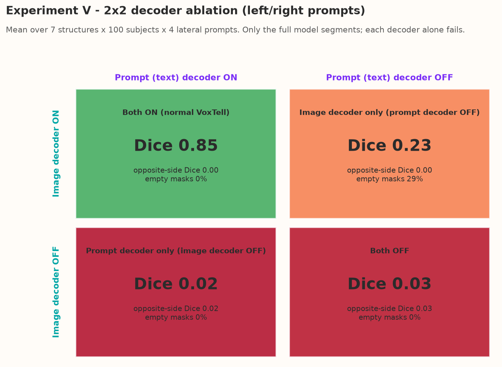

**In one paragraph:** The 2×2 grid lays out the four settings like a truth table: columns switch the prompt (text) decoder on/off, rows switch the image decoder on/off, and the colour shows how good the masks are. Only the top-left box (normal VoxTell) is green. Turning off the prompt decoder (top-right) costs most of the accuracy and leaves 29 % of masks empty, but those masks that remain never land on the wrong side. Turning off the image decoder (bottom row) gives practically zero accuracy whether or not the prompt decoder is on. In short: both decoders are needed, but the image decoder is the one that cannot be done without.

**Main findings:**

- Both ON: Dice 0.85; prompt decoder OFF: 0.23 (29 % empty); image decoder OFF: 0.02; both OFF: 0.03.
- With the prompt decoder off, masks never land on the wrong side (opposite-side Dice 0.00).
- The image decoder is the component VoxTell cannot do without.

| Setting | Dice (left/right prompts) | Dice with opposite side | Empty masks |
|---|---:|---:|---:|
| Both ON | **0.85** | 0.00 | 0 % |
| Image decoder only | 0.23 | 0.00 | 29 % |
| Prompt decoder only | 0.02 | 0.02 | 0 % |
| Both OFF | 0.03 | 0.03 | 0 % |

**Only the complete model segments.** Each decoder alone fails, but in different ways.

### 3.2 Per structure — [`exp5_02_dice_heatmap_by_structure.png`](plots/exp5_02_dice_heatmap_by_structure.png)

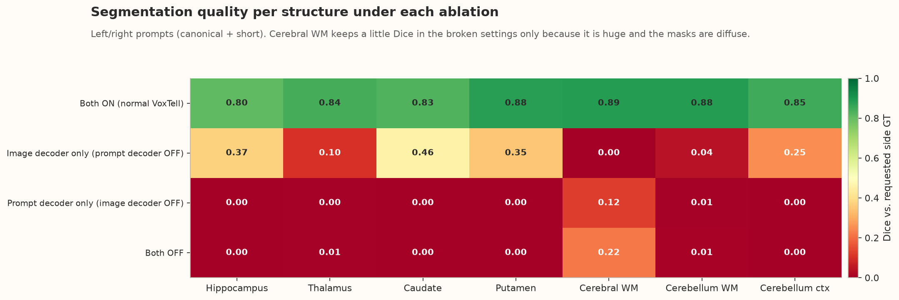

**In one paragraph:** This heat-map repeats the comparison per structure. The top row (normal model) is uniformly green (0.80–0.89). In the second row (prompt decoder off) the small deep nuclei keep some accuracy (0.35–0.46) while the large white-matter structures fail completely, suggesting the raw text embedding is enough to roughly locate compact, well-known structures but not large, irregular ones. The bottom two rows (image decoder off) are red everywhere; the small values for cerebral white matter are not real segmentation but chance overlap of a huge noisy mask with a huge structure.

**Main findings:**

- Full model: 0.80–0.89 for every structure.
- Prompt decoder off: deep nuclei keep 0.35–0.46, large white-matter structures fail (0.00–0.04).
- Image decoder off: ≈ 0 everywhere (cerebral WM 0.12–0.22 is chance overlap).

With the prompt decoder bypassed, the small deep nuclei still reach Dice 0.35–0.46 (caudate 0.46, hippocampus 0.37, putamen 0.35), whereas large structures (cerebral WM 0.00, cerebellum WM 0.04) fail. With the image decoder bypassed, everything is ≈ 0 (the 0.12–0.22 for cerebral WM is chance overlap of a huge diffuse mask with a huge structure).

### 3.3 Which pathway carries the side word? — [`exp5_03_laterality_by_setting.png`](plots/exp5_03_laterality_by_setting.png)

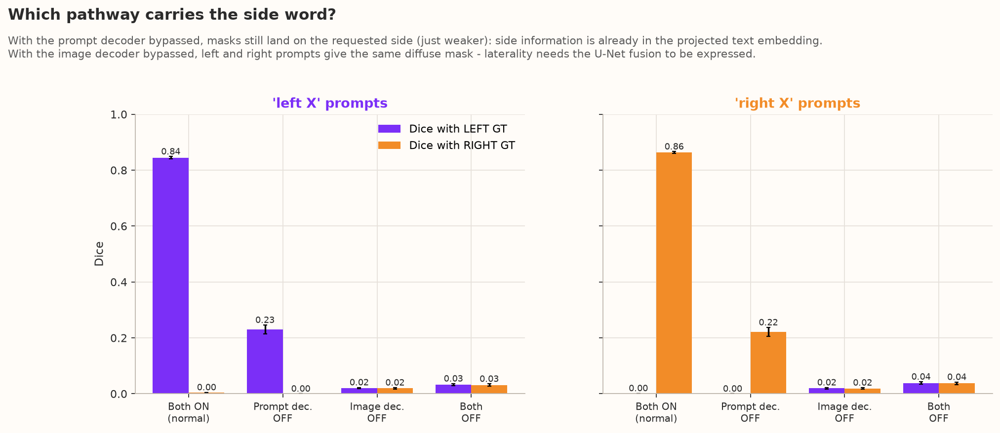

**In one paragraph:** This figure answers the plan's key question: which pathway carries "left" vs "right"? Under "Prompt dec. OFF", the purple bar is the only bar in the left panel and the orange bar the only bar in the right panel — weaker than normal, but still on the correct side and never on the wrong one. So even without the cross-attention layers, VoxTell still knows which side was asked for. Under "Image dec. OFF" and "Both OFF", purple and orange bars are equal and tiny: without the U-Net, the side word has no visible effect on where the mask is. The side is therefore *encoded* in the text embedding but *expressed* by the image decoder.

**Main findings:**

- Prompt decoder off: "left" → left GT only (0.23), "right" → right GT only (0.22).
- Image decoder off: equal tiny overlap with both sides (0.02 / 0.02).
- Side is *encoded* in the text embedding, *expressed* by the image decoder.

- **Prompt decoder OFF:** "left X" still overlaps only the left GT (0.23 vs 0.00) and "right X" only the right GT (0.22 vs 0.00). → **The side information is already present in the projected Qwen3 embedding**; the cross-attention layers are not needed to know *which side*.
- **Image decoder OFF:** left and right prompts overlap both sides equally (0.02 vs 0.02). → **Without the U-Net fusion the side cannot be expressed spatially.**

### 3.4 How the broken settings fail — [`exp5_04_failure_modes_overlap_empty_volume.png`](plots/exp5_04_failure_modes_overlap_empty_volume.png)

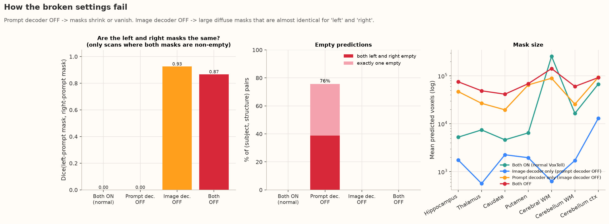

**In one paragraph:** The three panels show *how* the broken settings fail. Left: the left-prompt and right-prompt masks never overlap in the normal model or with the prompt decoder off (0.00), but are almost the same mask (0.87–0.93) whenever the image decoder is off. Middle: with the prompt decoder off, three quarters of the structure/subject pairs lose at least one of their two masks (39 % lose both). Right: the prompt-decoder-off masks are tiny (around a thousand voxels), while image-decoder-off masks are tens of thousands of voxels — far larger than the real structures. So the two decoders fail in opposite ways: without the prompt decoder VoxTell becomes too timid, without the image decoder it becomes indiscriminate.

**Main findings:**

- Left/right mask overlap: 0.00 (full / prompt-decoder-off) vs 0.87–0.93 (image decoder off).
- Prompt decoder off: 39 % both masks empty, 37 % one mask empty.
- Prompt decoder off → too small (~10³ voxels); image decoder off → too large (10⁴–10⁵ voxels).

- **Left panel:** Dice between the left-prompt and right-prompt masks (only where both are non-empty). Both ON and prompt-decoder-OFF: **0.00** (sides stay separate). Image-decoder-OFF: **0.93**, Both OFF: **0.87** (left and right give practically the same mask).
- **Middle panel:** with the prompt decoder OFF, **39 %** of (subject, structure) pairs have *both* left and right masks empty and another **37 %** have one empty. (The summary table's `dice_left_vs_right_overlap` of 1.0 for some structures in this setting is an artefact of comparing two empty masks.)
- **Right panel:** prompt-decoder-OFF masks are tiny (~10³ voxels); image-decoder-OFF masks are huge and diffuse (~10⁴–10⁵ voxels, scattered over the whole brain).

### 3.5 Wording sensitivity — [`exp5_05_wording_sensitivity_by_setting.png`](plots/exp5_05_wording_sensitivity_by_setting.png)

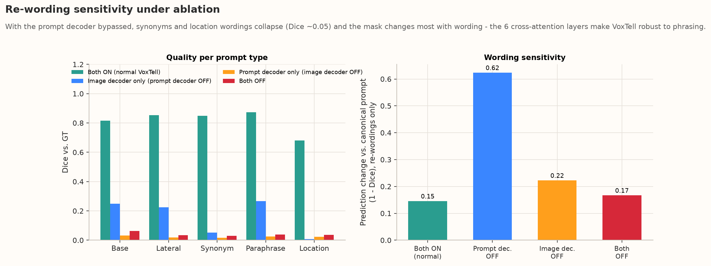

**In one paragraph:** This is Experiment II repeated in each setting. In the left panel, the normal model (green) is accurate for every prompt type; with the prompt decoder off (blue), the canonical, short and paraphrase prompts keep about a quarter of their accuracy, but synonyms and location descriptions drop to almost nothing. The right panel shows that re-wording changes the mask four times more without the prompt decoder (0.62 vs 0.15). The six cross-attention layers of the prompt decoder are therefore what maps different wordings of the same structure onto the same place in the image — they are VoxTell's "synonym normaliser".

**Main findings:**

- Without the prompt decoder, synonyms drop to Dice 0.05 and location descriptions to 0.01.
- Re-wording changes the mask 4× more (0.62 vs 0.15).
- The prompt decoder is VoxTell's "synonym normaliser".

When the prompt decoder is bypassed, synonyms collapse (Dice **0.05**, vs 0.85 in the full model) and location descriptions vanish (0.01), while the canonical/short/paraphrase prompts keep ~0.23–0.27. The mask change caused by re-wording jumps from **0.15 → 0.62**.
→ **The 6 cross-attention layers are what make VoxTell robust to phrasing**: they pull different wordings of the same structure onto the same image region.

### 3.6 Example masks — [`exp5_06_example_masks_hippocampus_0086.png`](plots/exp5_06_example_masks_hippocampus_0086.png), [`exp5_06_example_masks_hippocampus_0001.png`](plots/exp5_06_example_masks_hippocampus_0001.png), [`exp5_06_example_masks_hippocampus_0031.png`](plots/exp5_06_example_masks_hippocampus_0031.png); [`exp5_06_example_masks_caudate_0086.png`](plots/exp5_06_example_masks_caudate_0086.png), [`exp5_06_example_masks_caudate_0001.png`](plots/exp5_06_example_masks_caudate_0001.png), [`exp5_06_example_masks_caudate_0031.png`](plots/exp5_06_example_masks_caudate_0031.png)

*The three example subjects were picked by their mean Dice on the plain base/left/right sentences in Experiment I: **OAS1_0086** is the median (typical) subject, **OAS1_0001** sits at the lower quartile, and **OAS1_0031** is the hardest of the 100 scans. Together they show what VoxTell does on a normal, a slightly worse and a difficult brain.*

**Subject OAS1_0086 (typical case — median subject)**

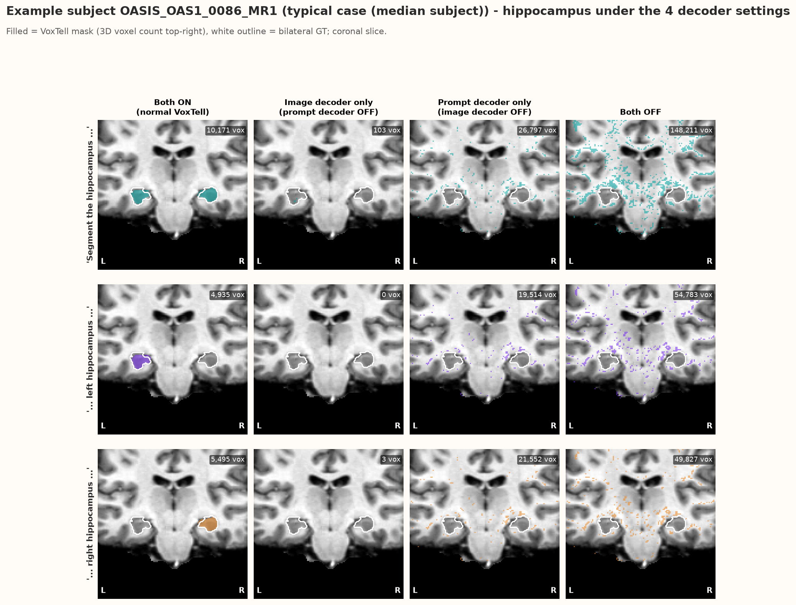
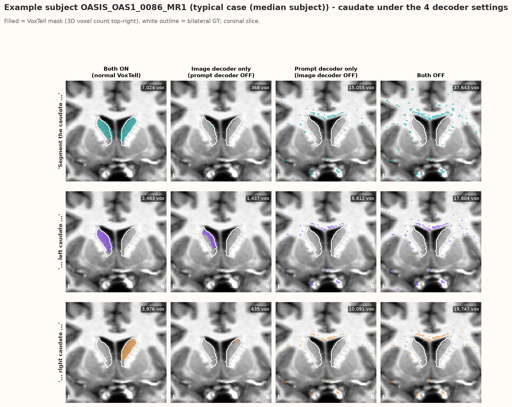

**Subject OAS1_0001 (lower-quartile subject)**

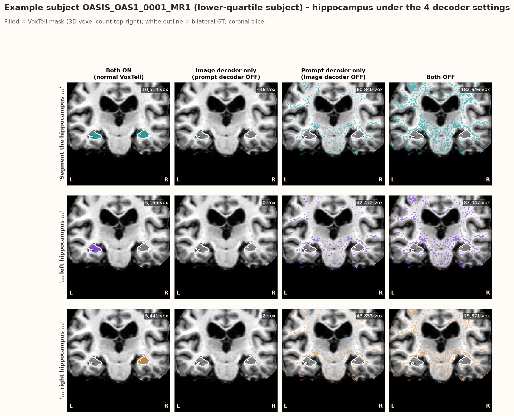
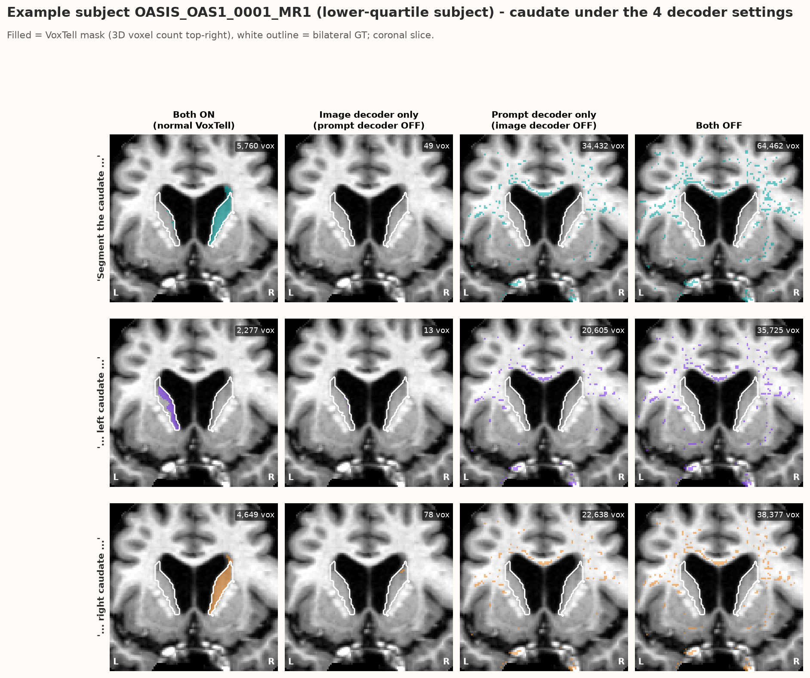

**Subject OAS1_0031 (hardest subject of the 100)**

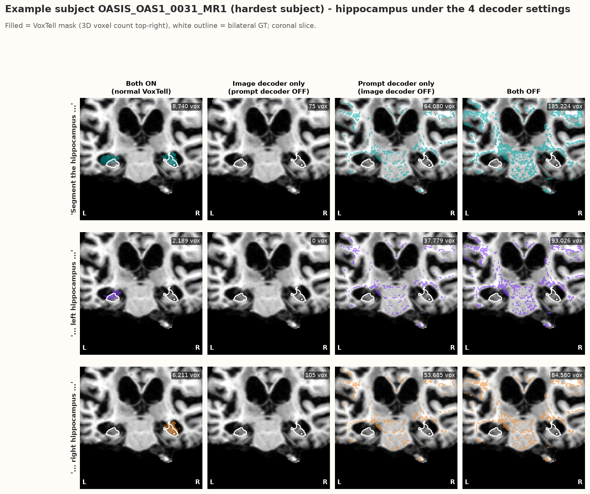
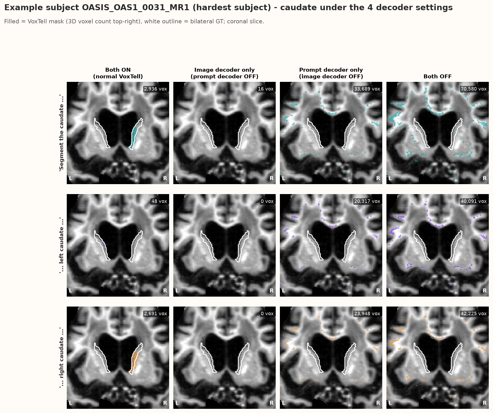

**Simple reading of the example masks (OAS1_0001):** In both figures (hippocampus and caudate of one patient), each row is one prompt (no side, left, right) and each column one decoder setting; the white outline is the real structure and the number in the corner is how many voxels VoxTell segmented in 3D. In the first column (normal VoxTell) the colour neatly fills both structures, only the left one, or only the right one, as asked (for the caudate, the no-side prompt again favours the right side). In the second column (prompt decoder off) the masks almost vanish — only 0–450 voxels remain, too few to see. In the third and fourth columns (image decoder off) the colour is sprinkled all over the brain (20,000–180,000 voxels) and looks the same for "left", "right" and no side. The pictures make the numbers concrete: the full model draws anatomy; each crippled version either draws nothing or draws noise.

**Main findings:**

- **OAS1_0086 (typical):** the full model gives clean masks (hippocampus 10,171 / 4,935 / 5,495 voxels for none / left / right). With the prompt decoder off, the hippocampus vanishes (0–103 voxels) while the caudate keeps a small mask (368–1,437 voxels). With the image decoder off, 9,000–27,000 scattered voxels appear, similar for every side.
- **OAS1_0001 (lower quartile):** as described above — 0–446 voxels without the prompt decoder, 20,000–180,000 noisy voxels without the image decoder.
- **OAS1_0031 (hardest):** even the full model nearly fails on the *left caudate* (48 voxels) while the right caudate is normal (2,691 voxels) — the same left-side failure seen in Experiments I, II and IV for this patient. With the prompt decoder off the caudate is completely empty (0–16 voxels); with the image decoder off it is again 20,000–70,000 scattered voxels.
- **Across all three subjects:** full model = anatomy; prompt decoder off = (almost) nothing; image decoder off = noise that ignores the side word. The failure modes are identical in every patient.

Subject OAS1_0001. Full model: clean bilateral / left / right masks. Prompt decoder OFF: tiny or empty masks. Image decoder OFF / both OFF: tens of thousands of scattered voxels, the same pattern for "left", "right" and no side.

## 4. Why is this happening?

- The **image decoder (U-Net)** is what turns a "query vector" into a sharp, spatially coherent 3D mask. Without it, a dot product between low-level stem features and the query lights up voxels of similar intensity everywhere — no anatomy, no side.
- The **prompt decoder** adapts the generic text embedding to the specific image. Without it, the raw projected embedding is "off-distribution" for the U-Net fusion: canonical prompts (closest to training data) still partially work, unusual wordings do not.
- **Side information is encoded early** (already in the projected text embedding) but only **realised in the image-decoder fusion** — consistent with Experiment III, where the left/right gap was amplified at the fusion stages.

## 5. Limitations

- Ablations are done **without retraining**, so a broken setting also suffers from distribution shift; the results show which components are *necessary*, not how well a smaller model could do if trained that way.
- The "image decoder OFF" path uses the full-resolution stem features with the stage-0 mask embedding — one reasonable bypass among several possible designs.
- Overlap metrics are misleading when masks are empty; we report empty rates separately (Figure 3.4).

## 5b. Answers to the research questions

| # | Question | What we found | Answer |
|---|---|---|---|
| **G1** | Which components are necessary? | Dice 0.85 (both) → 0.23 (prompt decoder off) → 0.02 (image decoder off) → 0.03 (both off) | **Both are necessary; the image decoder is indispensable** |
| **G2** | Does the text (prompt) decoder carry side information? | With it switched off, left/right outputs are **not** identical: they stay on their own sides (opposite-side Dice 0.00, left/right overlap 0.00) | ❌ **No** — by the plan's rule, the prompt decoder is *not* what carries the side; the side is already in the projected Qwen3 embedding |
| **G3** | Does the image decoder carry / express the side? | With it switched off, left and right masks become nearly identical (overlap 0.93) and equally poor on both sides | ✅ **Yes** — the side can only be expressed through the U-Net fusion |
| **G4** | What makes VoxTell robust to re-wording? | Prompt decoder off: synonyms Dice 0.85 → 0.05, re-wording mask change 0.15 → 0.62 | **The prompt decoder's cross-attention** |
| **G5** | Implication for the "small solution" | Text embedding must keep its side direction; prompt decoder needed for wording robustness; U-Net fusion needed to realise the side | **Keep both decoders; intervene at the text–image fusion** |

**In one paragraph:** Applying the decision rule from the Axis II plan, the text (prompt) decoder is **not** the pathway that carries side information — when it is removed, "left" and "right" still produce masks on the correct sides, so the side is already present in the projected text embedding. The image decoder, on the other hand, is required for the side to have any spatial effect: without it, left and right prompts give the same noisy output. The prompt decoder's real job is to make the query robust to phrasing and confident enough to produce full-size masks. Together with Experiment III, this gives a consistent picture: the side word enters early through the text embedding, is kept (but not amplified) by the prompt decoder, and is turned into an actual left or right mask — and biased towards the right — at the text–image fusion inside the U-Net.

**Main findings:**

- By the plan's rule, the prompt decoder does **not** carry side information (G2 ❌).
- The image decoder is required to express the side (G3 ✅) and is indispensable (G1).
- The prompt decoder provides wording robustness (G4).
- For a fix, keep both decoders and intervene at the text–image fusion (G5).

## 6. Verdict

| Question | Answer |
|---|---|
| Is each decoder necessary? | **Yes.** Full model Dice 0.85 → 0.23 without the prompt decoder → 0.02 without the image decoder. |
| Where is laterality *encoded*? | **Already in the projected text embedding** — even with the prompt decoder bypassed, masks stay on the requested side (opposite-side Dice 0.00). |
| Where is laterality *expressed*? | **In the U-Net image-decoder fusion.** Without it, left and right prompts give the same mask (overlap 0.93). |
| What makes VoxTell robust to synonyms? | **The prompt decoder's cross-attention.** Without it, synonyms drop to Dice 0.05 and re-wording changes the mask 4× more. |

**Bottom line:** VoxTell needs both decoders. The side word is understood from the text embedding, but the U-Net fusion is where it becomes a left or right mask — which is also where Experiment III located the right-hemisphere bias. Interventions to fix the laterality bias should therefore target the text-to-image fusion stages.
