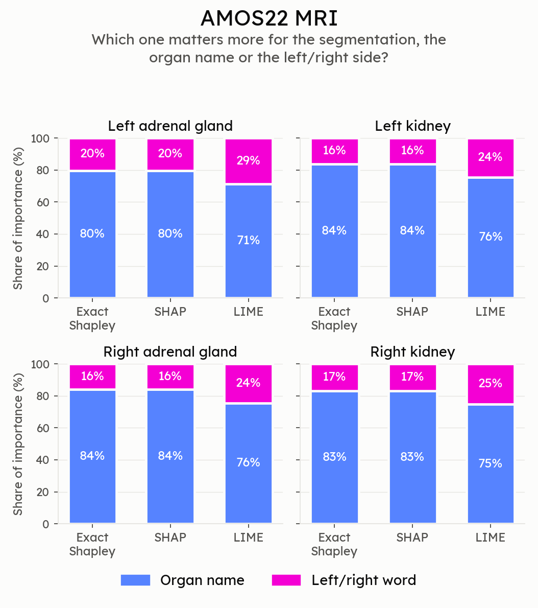
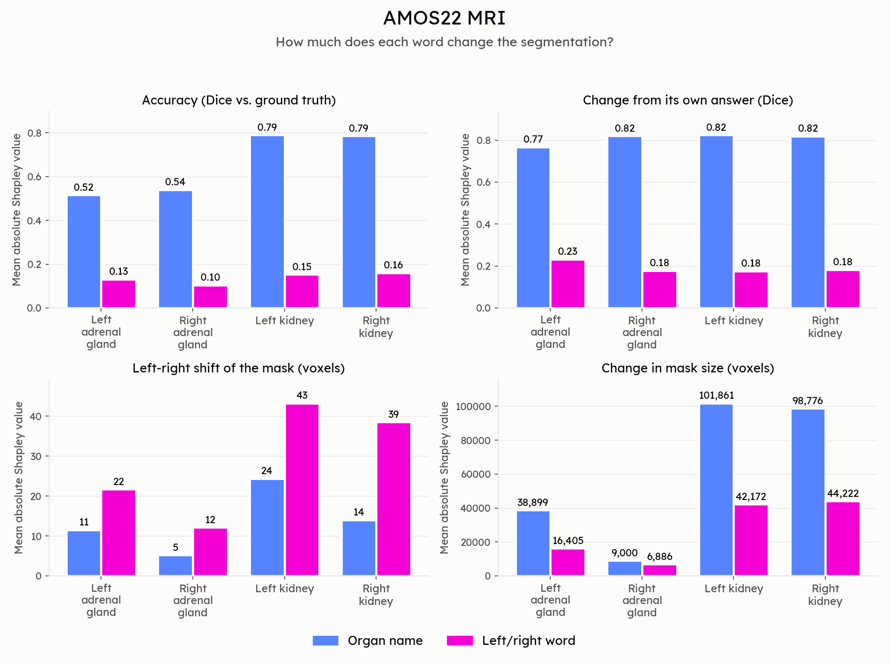
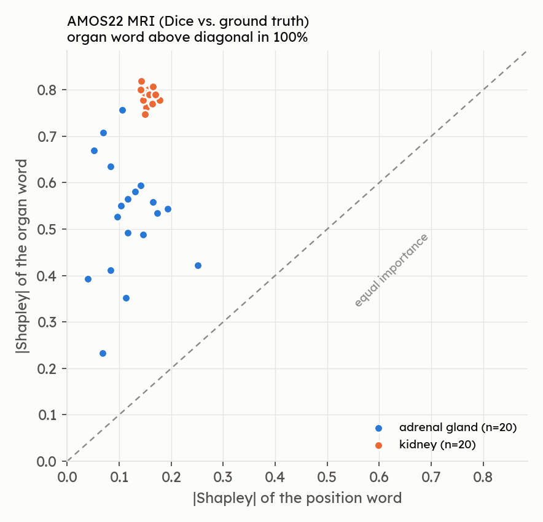

# VoxTell Groundedness Investigation — Results: AMOS22 MRI

Source: `Voxtell-Amos-Groundness/*.csv` (13 CSVs, generated by
`voxtell-amos-groundedness-investigation`). Plan: `voxtell-model-internals-investigation-plan.md`.

**Scope actually run:** 10 subjects × 4 bilateral organs (left/right kidney, left/right adrenal gland)
= 40 (subject, organ) instances, 20 left/right pairs, no rotation, one prompt template
(`"Segment the {left|right} {organ} in this image."`).

## Bottom line

> The position word is **genuinely used**: it is the selector that picks one side. Without it, VoxTell
> segments *both* kidneys/adrenals. The organ word is **more necessary** than the position word
> (drop it and the target is lost entirely). No evidence of a fixed left/right shortcut; there is no left/right
> accuracy asymmetry. The only rows that point the other way (row 2) are not informative because of how
> the regression is built (see row 2).

## 0. Baseline segmentation quality (context for everything below)

| Organ | n | Mean Dice vs GT | Std | Min | Left Dice | Right Dice |
|---|---|---|---|---|---|---|
| Kidney | 20 | **0.944** | 0.018 | 0.897 | 0.943 | 0.946 |
| Adrenal gland | 20 | **0.646** | 0.130 | 0.301 | 0.647 | 0.646 |
| All | 40 | 0.795 | | | | |

- 0 empty predictions. Predicted side (by centroid) matched the GT side in **40/40** instances.
- No left-vs-right asymmetry (kidney 0.943 vs 0.946, adrenal 0.647 vs 0.646).

## 1. Ablation conditions (what rows 5–11 are built on)

Mean over all instances, by which words were kept:

| Condition | Prompt example | Dice vs GT | Dice vs own baseline | Empty masks | \|centroid shift\| (vox) |
|---|---|---|---|---|---|
| Both present (baseline) | Segment the left kidney… | 0.795 | 1.000 | 0% | 0 |
| Position removed | Segment the kidney… | 0.521 | 0.616 | 0% | 45.2 |
| Organ removed | Segment the left structure near the liver… | 0.000 | 0.000 | 10% | 18.0 |
| Both removed | Segment the structure near the liver… | 0.001 | 0.000 | 0% | 30.3 |

By organ:

| Organ | Condition | Dice vs GT | Predicted voxels (mean) | Empty | Signed shift (vox) |
|---|---|---|---|---|---|
| Kidney | both present | 0.944 | 68,880 | 0% | 0 |
| Kidney | position removed | 0.631 | 147,226 | 0% | −0.9 |
| Kidney | organ removed | 0.000 | 3,711 | 5% | −8.6 |
| Adrenal | both present | 0.646 | 1,134 | 0% | 0 |
| Adrenal | position removed | 0.411 | 2,117 | 0% | 3.2 |
| Adrenal | organ removed | 0.000 | 14,384 | 15% | −3.8 |

**Key finding (position removed = "the kidney"):** predicted volume roughly doubles (68.9k → 147.2k voxels
for kidney) and Dice vs GT drops to ≈0.63, which is exactly what you get if the model segments *both* kidneys
(2·0.94/(1+2) ≈ 0.63). I decoded the masks to confirm: with the position word removed, the mask covers
**96%** of the correct kidney and **96%** of the *opposite* kidney (adrenal: 60% / 60%). Signed centroid shift
for that condition is **+57 vox for left targets and −59 vox for right targets**, i.e. the centroid
moves to the midline (half the ~117-vox kidney separation), not to the wrong side.

## 2. Answers to the plan's questions

### Core question — what drives the output: image, "right", "kidney", or a memorized prior?

- **Organ word ("kidney")** is the dominant driver of *what* is segmented (removing it → Dice ≈ 0).
- **Position word ("left"/"right")** is the driver of *which side*: removing it produces a bilateral
  (both-sides) mask, and keeping it produces the correct single side in 40/40 cases.
- **Image** is what supplies the anatomy (Dice 0.94 on kidney), and prompts differing only in "left"/"right"
  produce non-overlapping masks (IoU 0.0) on the correct sides.
- **Fixed memorized left/right prior:** not supported. A fixed pose prior would make the side independent
  of the word; here the side follows the word in every instance.

### Row 1 — Image–text alignment (matched vs mismatched IoU)

| Organ | n pairs | IoU matched | IoU mismatched | Grounded |
|---|---|---|---|---|
| Kidney | 10 | 0.892 | 0.000 | 10/10 |
| Adrenal gland | 10 | 0.496 | 0.000 | 10/10 |
| All | 20 | 0.694 | 0.000 | **20/20** |

**Answer by the plan's criteria:** high overlap for the matched prompt and none for the mismatched one →
a real link between the word and the image region. **Caveat:** this is measured on final masks, not
internal activations, and left/right organs never overlap, so `iou_mismatched` is ≈0 by construction. Read it
as "the word moves the output to the right side", not as proof of an internal activation alignment.

### Row 2 — Embedding distance vs output distance

| | Value |
|---|---|
| Fitted slope (centroid-distance per unit cosine-distance) | −4,156 |
| Intercept / R² / n | 794 / 0.514 / 20 |
| Pooled correlation | −0.72 |
| Within-kidney correlation / within-adrenal correlation | −0.33 / +0.08 |

| Organ | Cosine dist (mean ± sd) | Output centroid dist (vox, mean ± sd) |
|---|---|---|
| Kidney | 0.1630 ± 0.0001 | 116.6 ± 33.8 |
| Adrenal | 0.1757 ± 0.0001 | 64.1 ± 17.9 |

**Answer by the plan's rule:** negative/flat slope → "shortcut/memorized". **My reading: uninformative.**
The x-values take only two distinct values (one per organ type; within-organ sd = 0.0001), so the
regression just compares kidney vs adrenal. Output distance here reflects *anatomical separation* of the two
organs (kidneys sit further apart than adrenals), not how the model reacts to the words. The negative sign is
between-organ anatomy, not a property of the fusion. This row does not contradict rows 1/3/10; it just
can't test the question with this design.

### Row 3 — Causal embedding swap

| Organ | Left prompt → left side | Right prompt → right side | Both |
|---|---|---|---|
| Kidney | 10/10 | 10/10 | 10/10 |
| Adrenal | 10/10 | 10/10 | 10/10 |

**Answer:** 20/20 pairs. **Caveat:** as implemented this is the baseline side-accuracy for the two prompts, not
a mid-pipeline substitution (passing a different `text_embeddings` is the same as prompting differently, and
the image encoder never sees the text). It supports "the text embedding controls the side" but it is not an
independent causal test beyond row 1. The stronger causal evidence is the position-removal result in
section 1 (the side selector disappears when the word does).

### Row 4 — Fused feature-map (raw logit) difference, left vs right prompt

| Organ | Mean \|logit diff\| | Max \|logit diff\| | Fraction of voxels whose sign flips |
|---|---|---|---|
| Kidney | 30.1 | 138.3 | 0.93% |
| Adrenal | 18.2 | 178.4 | 0.02% |

**Answer:** a large, clear divergence between the two prompts on every pair (no pair with near-zero diff);
the flip fraction is of the order of the two organs' combined volume, consistent with the difference being
concentrated at the organs. → the internal signal tracks the word. **Not analysed:** where in the network
divergence first appears (only the final logits were compared) and the argmax location vs the GT side.

### Figures: exact Shapley, SHAP and LIME (rows 5–7)

Generated by `python scripts/plot_attribution_summary.py` into `local_plots_groundedness/summary/`.

- **Method comparison** (share of importance carried by the position word vs. the organ word, per method):
  `local_plots_groundedness/summary/amos_method_share.png`
- **Word attribution: exact Shapley (= SHAP) of each word for the four target metrics, left and right shown separately:**
  `local_plots_groundedness/summary/amos_word_attribution.png`
- **Every instance, position vs. organ importance:**
  `local_plots_groundedness/summary/amos_position_vs_organ.png`

### Row 5 — Exact Shapley (method)

Mean \|Shapley value\|, by role and metric (40 instances):

| Metric | Position | Organ | Organ > position in |
|---|---|---|---|
| f_dice_gt | 0.137 | **0.658** | 40/40 |
| f_dice_self | 0.192 | **0.808** | 40/40 |
| f_centroid_shift (vox) | **28.9** | 13.8 | 8/40 |
| f_volume (vox) | 27,421 | **62,134** | 33/40 |

Ranking: **organ ≫ position for correctness/self-consistency**, but position is larger for L/R shift.
Note that with only two words the position share can't be compared against a noise floor (no function-word control).

### Row 6 — LIME

Mean \|weight\| (Dice-vs-GT target): organ **0.0024**, position **0.0008**. Same ranking as exact Shapley
(organ > position), but weights are two orders of magnitude smaller (LIME's regularization on a 1-word document); use for rank
agreement only.

### Row 7 — KernelSHAP

0 of 320 rows differ from the exact Shapley value by >1e-4 (expected at 2 features; this is agreement by
construction, not independent validation).

### Row 8 — `f_dice_gt` (accuracy)

Removing the **organ** costs ≈0.66 Dice; removing the **position** costs ≈0.14 (kidney 0.16, adrenal 0.12).
The organ word is what matters for getting the *right structure*; the position word costs less because a
both-sides mask still overlaps the target.

### Row 9 — `f_dice_self` (sensitivity to own answer)

Organ 0.81, position 0.19. Removing the organ completely changes the answer (Dice vs own baseline 0.00);
removing position keeps 0.62 of it.

### Row 10 — `f_centroid_shift` (laterality)

Position removal produces a consistent, *opposite-signed* shift: **+57 vox (left targets), −59 vox (right
targets)** for kidney; **+35 / −29** for adrenal, pointing to the midline. That is the clear position signal
the plan asked for: without the word the answer no longer sits on the named side. Organ removal shifts less
(−8.6 vox kidney) because the mask moves to an unrelated structure rather than to the other side.

### Row 11 — `f_volume` (collapse)

Not a collapse: position removal *increases* volume (kidney 68.9k → 147.2k) because both sides are
segmented. Organ removal collapses/changes the target with 5% (kidney) and 15% (adrenal) empty masks.

## 3. Mechanistic side analysis (files 11–13)

| Space | Mean cosine similarity of the (right − left) direction across organ pairs (kidney vs adrenal) |
|---|---|
| Text (Qwen) | **0.963** |
| Fused (after cross-attention) | **0.680** |
| Delta | −0.282 |

The raw text embeddings share an almost identical "right−left" direction across organs. After fusion the
direction becomes markedly more organ-specific. Caveats: the two spaces have different dimensions (cosines are
not strictly comparable), fused vectors are averaged over all sliding-window patches, only one organ pair is compared, and there is
no null direction (e.g. big−small) for calibration.

## 4. Limitations

- 10 subjects, 2 organ types, one template, no rotation, no confidence intervals.
- Row 1 and row 3 are output-level (final masks); row 3 is not a true embedding swap.
- Row 2 regression is degenerate (two x-values).
- AMOS may be in VoxTell's training data, so "grounded" here is not evidence of generalization to unseen data.
- Only the text was ablated: no image flip / blank-image / organ-erasure control was run, so "image vs. memorized
  location prior" is not directly tested.
