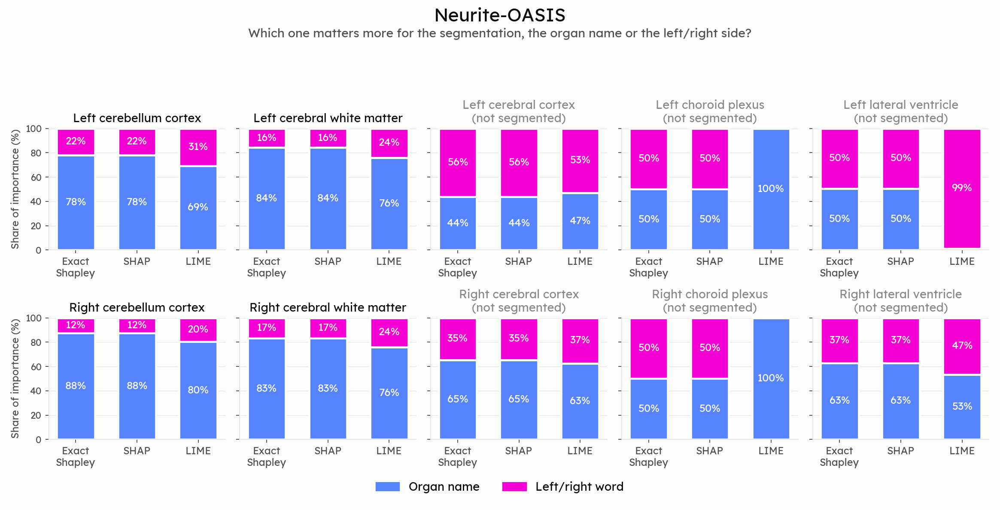
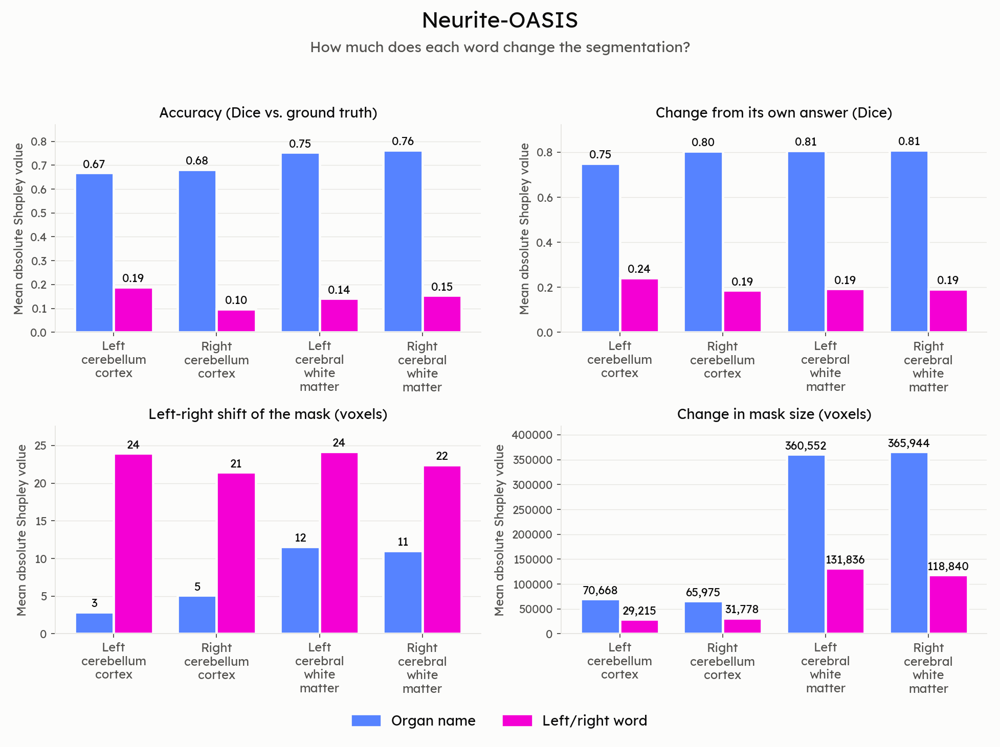
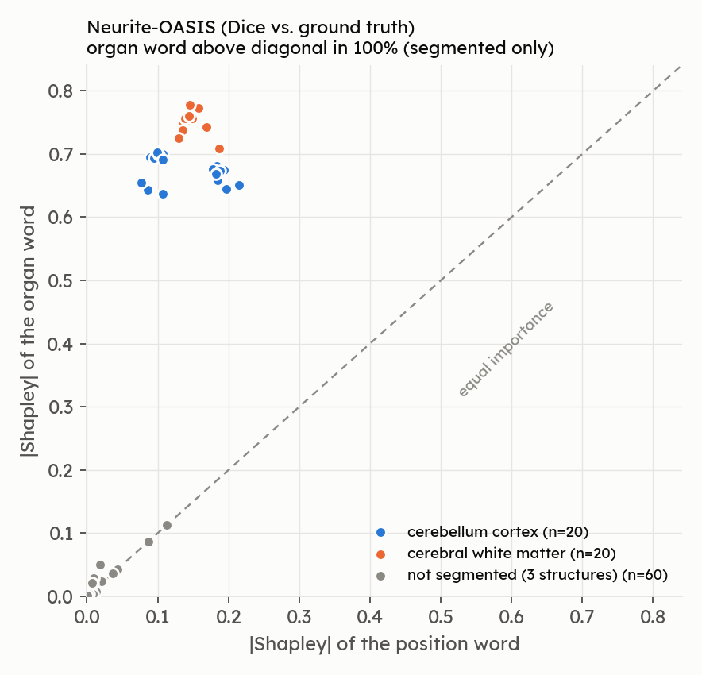

# VoxTell Groundedness Investigation — Results: Neurite-OASIS

Source: `Voxtell-OASIS-Batch1-Groundness/*.csv` + `Voxtell-OASIS-Batch2-Groundness/*.csv` (26 CSVs; two
disjoint 5-subject batches pooled = all 10 available OASIS subjects). Plan:
`voxtell-model-internals-investigation-plan.md`.

**Scope actually run:** 10 subjects × 10 bilateral structures (5 left/right pairs: cerebral cortex,
cerebral white matter, cerebellum cortex, lateral ventricle, choroid plexus) = 100 (subject, organ)
instances, 50 pairs, no rotation, one prompt template.

## Bottom line

> VoxTell can only be tested for grounding on **2 of the 5 structures** — cerebral white matter and
> cerebellum cortex. On those, the result matches AMOS: the position word is the side selector (removing it
> gives a both-hemisphere mask) and the organ word is more necessary than the position word. The other three
> structures (cerebral cortex, lateral ventricle, choroid plexus) are **not segmented correctly even with the
> full, correct prompt** (Dice ≤ 0.02), so every row that is averaged over them is dominated by failure to
> segment, not by grounding. Pooled "grounding rates" (e.g. 66%, 68%) mostly measure that failure.

## 0. Baseline segmentation quality

| Structure | n | Mean Dice vs GT | Empty predictions | Mean predicted voxels | Left Dice | Right Dice |
|---|---|---|---|---|---|---|
| Cerebral white matter | 20 | **0.906** | 0% | 238,090 | 0.894 | 0.917 |
| Cerebellum cortex | 20 | **0.829** | 0% | 64,566 | 0.866 | 0.793 |
| Cerebral cortex | 20 | 0.017 | 0% | 3,435 | 0.021 | 0.012 |
| Lateral ventricle | 20 | 0.001 | 40% | 82 | 0.001 | 0.002 |
| Choroid plexus | 20 | 0.000 | **100%** | 0 | 0.000 | 0.000 |
| All | 100 | 0.351 | 28% | | | |

- Predicted side matched the GT side in 72/100 instances overall (100% on the two working structures).
- Small left/right differences on the working structures (cerebellum 0.866 vs 0.793, n=10 each) are not tested for significance.

**Consequence:** the "informative" subset is 40 instances (2 structures). I report both the pooled numbers
(as the notebooks compute them) and the informative-subset numbers below.

## 1. Ablation conditions

Pooled over all 100 instances:

| Condition | Dice vs GT | Dice vs own baseline | Empty masks | \|centroid shift\| (vox) |
|---|---|---|---|---|
| Both present (baseline) | 0.351 | 1.000 | 28% | 0 |
| Position removed | 0.243 | 0.474 | 20% | 21.5 |
| Organ removed | 0.009 | 0.026 | 13% | 5.2 |
| Both removed | 0.005 | 0.082 | 21% | 17.7 |

Informative structures only:

| Structure | Condition | Dice vs GT | Predicted voxels | Empty |
|---|---|---|---|---|
| Cerebral white matter | both present | 0.906 | 238,090 | 0% |
| | position removed | 0.624 | 492,389 | 0% |
| | organ removed | 0.014 | 3,802 | 45% |
| Cerebellum cortex | both present | 0.829 | 64,566 | 0% |
| | position removed | 0.544 | 113,168 | 0% |
| | organ removed | 0.012 | 14,349 | 0% |

**Key finding (position removed):** the predicted volume roughly doubles (white matter 238k → 492k, cerebellum
65k → 113k). Decoding the masks: the mask covers **88%** of the correct-side white matter and **88%** of the
opposite-side white matter (cerebellum: 72% / 72%). Signed centroid shift is **+29 / −28 vox** (left / right
white matter) and **+28 / −25** (cerebellum), moving toward the midline, the same pattern as AMOS.

## 2. Answers to the plan's questions

### Core question — what drives the output?

- On the working structures: the **organ word** decides *what* is segmented, the **position word** decides
  *which hemisphere*, and the image supplies the anatomy. There is no sign of a fixed left/right shortcut.
- For cerebral cortex, lateral ventricle and choroid plexus, **the model does not segment the structure at all**
  (Dice ≤ 0.02, up to 100% empty). Nothing can be concluded about position grounding for them; the causes were
  not investigated (possibilities: vocabulary/label mismatch, small size, or OASIS label definitions).

### Row 1 — Image–text alignment

| Structure | n pairs | IoU matched | IoU mismatched | Grounded |
|---|---|---|---|---|
| Cerebellum cortex | 10 | 0.763 | 0.000 | 10/10 |
| Cerebral white matter | 10 | 0.810 | 0.000 | 10/10 |
| Cerebral cortex | 10 | 0.011 | 0.000 | 10/10 (trivially: 0.011 > 0) |
| Lateral ventricle | 10 | 0.000 | 0.000 | 3/10 |
| Choroid plexus | 10 | 0.000 | 0.000 | 0/10 |
| All | 50 | 0.317 | 0.000 | 33/50 (66%) |

**Answer:** on cerebellum and white matter, the matched prompt overlaps and the mismatched one does not →
a real word–region link. The pooled 66% is not a measure of grounding; the 17 "failures" are structures the
model did not segment. (Same caveat as AMOS: final masks, and left/right never overlap, so IoU mismatched ≈ 0
by construction. Cerebral cortex's 10/10 is meaningless at IoU 0.011.)

### Row 2 — Embedding distance vs output distance

| Structure | Cosine dist | Output centroid dist (vox, mean ± sd) |
|---|---|---|
| Cerebellum cortex | 0.1427 | 53.4 ± 2.3 |
| Cerebral cortex | 0.1489 | 60.8 ± 6.3 |
| Cerebral white matter | 0.1395 | 56.5 ± 1.1 |
| Lateral ventricle | 0.0888 | 71.9 ± 2.9 |
| Choroid plexus | 0.1466 | undefined (empty predictions) |

Fitted per batch: slope −259 (R² 0.49, n=18) and −174 (R² 0.23, n=16).

**Answer by the plan's rule:** negative slope → "shortcut/memorized". **My reading: uninformative**, for the same
reason as in AMOS: each structure has one embedding distance (within-structure sd ≈ 0), so the fit compares
structure types. Choroid plexus points are missing (empty masks), and the 3 failing structures contribute noise.
The two fits are reported per batch because the notebooks fitted each batch separately.

### Row 3 — Causal embedding swap

| Structure | Left→left | Right→right | Both |
|---|---|---|---|
| Cerebellum cortex | 10/10 | 10/10 | 10/10 |
| Cerebral white matter | 10/10 | 10/10 | 10/10 |
| Cerebral cortex | 10/10 | 10/10 | 10/10 (at Dice 0.017) |
| Lateral ventricle | 4/10 | 8/10 | 4/10 |
| Choroid plexus | 0/10 | 0/10 | 0/10 |
| All | | | 34/50 (68%) |

**Answer:** on the working structures 20/20 pairs are correct. The pooled 68% again reflects segmentation
failures (choroid plexus is empty, ventricle is mostly empty). Cerebral cortex's 10/10 is a weak result: the prediction is tiny (≈3.4k voxels) but
on the right side. Same implementation caveat as AMOS: this is baseline side accuracy, not a real embedding swap.

### Row 4 — Raw logit difference, left vs right prompt

| Structure | Mean \|logit diff\| | Max \|logit diff\| | Voxels with sign flip |
|---|---|---|---|
| Cerebral white matter | 6.9 | 43.2 | 10.8% |
| Cerebellum cortex | 12.0 | 78.5 | 2.9% |
| Cerebral cortex | 6.9 | 39.0 | 0.16% |
| Lateral ventricle | 10.8 | 56.6 | 0.00% |
| Choroid plexus | **26.5** | 133.3 | **0.00%** |

**Answer:** on white matter and cerebellum there is clear divergence, with a flip fraction in line with the
structure size. Choroid plexus is the case the plan's row 4 warned about: the two prompts give very different
logits (largest mean diff of all) but **never cross the 0.5 threshold** on either side, so nothing is
predicted. Prompt-specific information exists internally, yet it never becomes a mask.

### Figures: exact Shapley, SHAP and LIME (rows 5–7)

Generated by `python scripts/plot_attribution_summary.py` into `local_plots_groundedness/summary/`.

- **Method comparison** (share of importance carried by the position word vs. the organ word, per method):
  `local_plots_groundedness/summary/oasis_method_share.png`
- **Word attribution: exact Shapley (= SHAP) of each word for the four target metrics, left and right shown separately:**
  `local_plots_groundedness/summary/oasis_word_attribution.png`
- **Every instance, position vs. organ importance:**
  `local_plots_groundedness/summary/oasis_position_vs_organ.png`

### Row 5 — Exact Shapley

Mean \|Shapley\|, pooled (100 instances) / informative structures only (40 instances):

| Metric | Position (pooled / informative) | Organ (pooled / informative) | Organ > position (informative) |
|---|---|---|---|
| f_dice_gt | 0.065 / 0.146 | 0.294 / **0.716** | 40/40 |
| f_dice_self | 0.286 / 0.203 | 0.703 / **0.793** | 40/40 |
| f_centroid_shift (vox) | 17.4 / **23.0** | 6.0 / 7.7 | 9/40 |
| f_volume (vox) | 56,770 / 77,917 | 153,747 / **215,785** | 40/40 |

Pooled, organ > position for f_dice_gt in 89% of instances; the 11% exceptions are all failing structures where
both values are ≈0. On the informative subset, organ > position for correctness in every case, while position
matters more for L/R centroid shift (the same pattern as AMOS).

### Row 6 — LIME

Mean \|weight\| pooled: organ **0.0010**, position **0.0004** (informative subset: 0.0026 / 0.0009). Same
ranking as exact Shapley, magnitudes far smaller (shrinkage).

### Row 7 — KernelSHAP

0 of 800 rows differ from exact Shapley by >1e-4 (agreement by construction at 2 features).

### Row 8 — `f_dice_gt`

Informative structures: removing the organ costs ≈0.72 Dice, removing the position ≈0.15. For the failing
structures every value is ≈0 (there is no accuracy to lose).

### Row 9 — `f_dice_self`

Informative: organ 0.79, position 0.20. **Artifact warning:** for structures with an empty baseline (choroid
plexus, 100%; ventricle, 40%), the code scores empty-vs-empty as Dice 1.0 (`dice_score` returns 1.0 when both
masks are empty). The choroid-plexus f_dice_self attribution (0.875 vs 0.125) is that artifact, not model
behavior, and it inflates the pooled `f_dice_self` numbers.

### Row 10 — `f_centroid_shift`

Removing the position word gives opposite-signed shifts toward the midline on the working structures
(white matter +29 / −28 vox, cerebellum +28 / −25), the clear laterality signal the plan asked for. For
ventricle and cortex the signed shifts (+8 / −36, +16 / −45) are computed on tiny or empty masks and are
unreliable; empty masks get a shift of 0 in the code, so choroid plexus shows exactly 0 (not a real "no shift").

### Row 11 — `f_volume`

Position removal doubles the volume on the working structures (both hemispheres). Organ removal:
white matter has 45% empty masks and drops to ≈3.8k voxels, i.e. it collapses, unlike position removal.
For the failing structures volumes are dominated by the baseline failing (e.g. cerebral cortex prompts
without an organ word return 210k–460k voxels, far more than the 3.4k baseline).

## 3. Mechanistic side analysis

| Space | Mean cosine of the (right − left) direction across the 10 pairs of structures (per-batch summary, 5 subjects) |
|---|---|
| Text | **0.949** |
| Fused | **0.562** |
| Delta | −0.387 |

Same direction as AMOS: near-identical shared left/right direction in the text embedding, much more
structure-specific after fusion. Text is 0.92–0.96 for every pair of structures; fused ranges 0.44–0.67.
Each batch's summary CSV covers its own 5 subjects; the text value is identical in both (0.949) because text embeddings don't depend on the image, and fused differs only slightly (0.5621 vs 0.5615). The numbers above use batch 1. Same caveats as AMOS
(different dimensionalities, patch-averaged fused vectors, no null direction). Note that three of the
five structures in this comparison are not segmented correctly.

## 4. Limitations

- Only 2 of 5 structures are informative; grounding conclusions rest on 40 instances (10 subjects × 2 structures × L/R).
- Row 2 regression is degenerate; row 3 is not a real swap; row 1 is at mask level.
- Empty-mask handling in `f_dice_self` (empty vs empty = 1.0) and `f_centroid_shift` (empty → 0) biases the
  failing structures.
- The bilateral organs were chosen as the largest by bbox volume, yet 3 of the 5 are not segmented; label
  definitions or prompt vocabulary for OASIS were not checked.
- OASIS may be in VoxTell's training data; no image-flip, blank-image or organ-erasure control was run.
